# General warnings

> # ⚠️ Fan Project ⚠️
> I'm an **inexperienced programmer**, a game master, and a lifelong Fallout fan.
> This is a fan project made:
> - Mainly for my own group.
> - By a non-native English speaker.
> - To learn stuff: expect bugs, shitty code, and things that still need improving.
> - By just me, in my free time: updates may be frequent or stop altogether.

> # ⚠️ WORK IN PROGRESS ⚠️
>
> - **This is an alpha project.** Many features and rules are incomplete, and calculations may be wrong. A selectable option is not necessarily fully supported.
> - **Please double-check calculations and data against your rulebooks and GM's decisions.** If something looks wrong, [open an issue on GitHub](https://github.com/vittoema96/vittoema96.github.io/issues).
> - The interface is mobile-first, primarily tested around **412 x 915 px**. Desktop has a two-panel layout, but device and browser coverage is limited.
> - **Back up your characters:** saves are local only. See [backups and transfers](#backups-and-transfers).

---

# Pip-Boy 3000 - PWA Companion App

# -> [**Open the app**](https://vittoema96.github.io) <-


A free, unofficial companion for a Fallout-themed tabletop RPG. Manage characters, inventory, companions, and dice rolls in a Pip-Boy-inspired interface, directly in your browser or as an installed Progressive Web App (PWA).

#### Languages 🇺🇸🇮🇹
English and Italian, selectable in Settings ⚙️.

---

## 📲 Install as an App (and run it offline)

You can use the app directly at [vittoema96.github.io](https://vittoema96.github.io); installation is optional.

- **Android / iOS:** look for **Install app** or **Add to Home Screen** in the browser's menu or share sheet.
- **Desktop:** supported browsers may show an install icon in the address bar or an installation menu entry.

The exact steps and availability depend on your browser and operating system. If installation is unavailable, you can still use the website.

For offline use, first load the app **while online** and allow its files to finish downloading and caching. Offline availability depends on that cache, not simply on having a home-screen icon. Clearing site data can remove both the offline cache and your saves.

---

# What is NOT present...

## ...and still needs implementation

There are no promised completion dates. If you need a particular missing rule, [open an issue](https://github.com/vittoema96/vittoema96.github.io/issues).

### Perk effects (~75% without an implementation)

As of **2026-11-26**, the app applies the effects of **36 of 183 perks** automatically.
**8 more are partly automated**: some of their effects work, others you must apply yourself.
The remaining **139 perks** have no automatic effects, so you must apply them yourself.

<details>
<summary>Perk status list</summary>

- ✅ **Automatic:** the app applies the perk's effects (you still need to check the perk's conditions).
- 🟡 **Partial:** some effects are applied; the column "What you apply yourself" says which ones are not.
- ❌ **Manual:** no effects are applied; the perk is shown for reference only.

| English name | Italian name | ID | Effects | What you apply yourself |
|---|---|---|---|---|
| Accuracy | Accuratezza | `perkAccuracy` | ❌ Manual | All of its effects |
| Action Boy/Girl | Uomo/Donna D’azione | `perkActionBoyGirl` | ❌ Manual | All of its effects |
| Adamantium Skeleton | Scheletro Di Adamantio | `perkAdamantiumSkeleton` | ❌ Manual | All of its effects |
| Adrenaline Rush | Scarica Di Adrenalina | `perkAdrenalineRush` | ✅ Automatic | – |
| All Night Long | Tutta la Notte | `perkAllNightLong` | ❌ Manual | All of its effects |
| Ammosmith | Fabbricante di Munizioni | `perkAmmosmith` | ❌ Manual | All of its effects |
| Animal Friend | Amico Degli Animali | `perkAnimalFriend` | ❌ Manual | All of its effects |
| Aqua Boy/Girl | Acquaticità | `perkAquaboyGirl` | ❌ Manual | All of its effects |
| Archer | Arciere | `perkArcher` | ✅ Automatic | – |
| Armorer | Armaiolo | `perkArmorer` | ❌ Manual | All of its effects |
| Awareness | Consapevolezza | `perkAwareness` | 🟡 Partial | Piercing bonus after aiming at a Close-range target is not applied: apply it yourself. |
| Barbarian | Barbaro | `perkBarbarian` | 🟡 Partial | Power Armor is not recognised yet, so the bonus is also applied while wearing it: remove it yourself when needed. |
| Basher | Sfondatore | `perkBasher` | ✅ Automatic | – |
| Better Criticals | Critici Migliorati | `perkBetterCriticals` | ❌ Manual | All of its effects |
| Big Leaguer | Pezzo Grosso | `perkBigLeaguer` | ✅ Automatic | – |
| Black Widow / Lady Killer | Vedova Nera / Sciupafemmine | `perkBlackWidowLadyKiller` | ❌ Manual | All of its effects |
| Blacksmith | Fabbro | `perkBlacksmith` | ❌ Manual | All of its effects |
| Blitz | Blitz | `perkBlitz` | ❌ Manual | All of its effects |
| Blocker | Difensore | `perkBlocker` | ❌ Manual | All of its effects |
| Bloodsucker | Bevitore di Sangue | `perkBloodsucker` | ❌ Manual | All of its effects |
| Bloody Mess | Carneficina | `perkBloodyMess` | ❌ Manual | All of its effects |
| Bodyguards | Guardie del Corpo | `perkBodyguards` | ❌ Manual | All of its effects |
| Born Survivor | Nato Sopravvissuto | `perkBornSurvivor` | ❌ Manual | All of its effects |
| Bow Before Me | Inchinati al Mio Arco | `perkBowBeforeMe` | ✅ Automatic | – |
| Bullet Shield | Scudo di Proiettili | `perkBulletShield` | ❌ Manual | All of its effects |
| Butcher's Bounty | Bottino del Macellaio | `perkButchersBounty` | ❌ Manual | All of its effects |
| Can Do! | Questo Può Andare! | `perkCanDo` | ❌ Manual | All of its effects |
| Cannibal | Cannibale | `perkCannibal` | ❌ Manual | All of its effects |
| Cap Collector | Collezionista Di Tappi | `perkCapCollector` | ❌ Manual | All of its effects |
| Cautious Nature | Prudente | `perkCautiousNature` | ✅ Automatic | – |
| Center Of Mass | Baricentro | `perkCenterOfMass` | 🟡 Partial | The free reroll only recognises the standard torso; creatures with other hit-location tables must be checked by you. |
| Chem Resistant | Resistente Alle Droghe | `perkChemResistant` | ❌ Manual | All of its effects |
| Chem Squeezer | Fiuta Farmaci | `perkChemSqueezer` | ❌ Manual | All of its effects |
| Chemist | Chimico | `perkChemist` | ❌ Manual | All of its effects |
| Class Freak | Fenomeno di Classe | `perkClassFreak` | ❌ Manual | All of its effects |
| Cola Nut | Amante della Cola | `perkColaNut` | ❌ Manual | All of its effects |
| Commando | Commando | `perkCommando` | ✅ Automatic | – |
| Community Organizer | Organizzatore della Comunità | `perkCommunityOrganizer` | ❌ Manual | All of its effects |
| Comprehension | Comprensione | `perkComprehension` | ❌ Manual | All of its effects |
| Concentrated Fire | Fuoco Concentrato | `perkConcentratedFire` | ❌ Manual | All of its effects |
| Contractor | Appaltatore | `perkContractor` | ❌ Manual | All of its effects |
| Covert Operator | Operatore Coperto | `perkCovertOperator` | ✅ Automatic | – |
| Crack Shot | Tiratore Preciso | `perkCrackShot` | ❌ Manual | All of its effects |
| Daring Nature | Ardito | `perkDaringNature` | 🟡 Partial | The free reroll for AP bought on skill tests with GM-granted AP is not applied: apply it yourself. |
| Dead Man Sprinting | Morto che Corre | `perkDeadManSprinting` | ❌ Manual | All of its effects |
| Demolition Expert | Esperto In Demolizione | `perkDemolitionExpert` | 🟡 Partial | The Vicious effect on Explosive attacks is applied; the explosive recipes it unlocks are not. |
| Dogmeat | Dogmeat | `perkDogmeat` | ✅ Automatic | – |
| Dromedary | Dromedario | `perkDromedary` | ❌ Manual | All of its effects |
| Dry Nurse | Balia Asciutta | `perkDryNurse` | ❌ Manual | All of its effects |
| Enforcer | Esecutore | `perkEnforcer` | ❌ Manual | All of its effects |
| Entomologist | Entomologo | `perkEntomologist` | ❌ Manual | All of its effects |
| Escape Artist | Artista della Fuga | `perkEscapeArtist` | ❌ Manual | All of its effects |
| Evasive | Evasivo | `perkEvasive` | ❌ Manual | All of its effects |
| Fast Metabolism | Metabolismo Veloce | `perkFastMetabolism` | ❌ Manual | All of its effects |
| Ferocious Loyalty | Lealtà Feroce | `perkFerociousLoyalty` | ❌ Manual | All of its effects |
| Field Surgeon | Chirurgo sul Campo | `perkFieldSurgeon` | ❌ Manual | All of its effects |
| Fire in the Hole | Al Riparo! | `perkFireInTheHole` | ❌ Manual | All of its effects |
| Fireproof | Ignifugo | `perkFireproof` | ❌ Manual | All of its effects |
| Fortune Finder | Cercatore Fortunato | `perkFortuneFinder` | ❌ Manual | All of its effects |
| Ghost | Spettro | `perkGhost` | ❌ Manual | All of its effects |
| Ghoulish | Ghoulesco | `perkGhoulish` | ❌ Manual | All of its effects |
| Gladiator | Gladiatore | `perkGladiator` | ✅ Automatic | – |
| Glow Sight | Visuale Luminosa | `perkGlowSight` | ❌ Manual | All of its effects |
| Goat Legs | Zampe di Capra | `perkGoatLegs` | ❌ Manual | All of its effects |
| Green Thumb | Pollice Verde | `perkGreenThumb` | ❌ Manual | All of its effects |
| Grim Reaper's Sprint | Tristo Mietitore | `perkGrimReaper` | ❌ Manual | All of its effects |
| Gun Fu | Boom-Fu | `perkGunFu` | 🟡 Partial | Follow-up attacks on extra targets (with their AP and ammo costs) are not handled: resolve them yourself. |
| Gun Nut | Fanatico Delle Armi | `perkGunNut` | ❌ Manual | All of its effects |
| Gun Runner | Corsaro Armato | `perkGunRunner` | ❌ Manual | All of its effects |
| Gunslinger | Pistolero | `perkGunslinger` | ✅ Automatic | – |
| Hacker | Hacker | `perkHacker` | ❌ Manual | All of its effects |
| Happy Camper | Campeggiatore Felice | `perkHappyCamper` | ❌ Manual | All of its effects |
| Happy Go Lucky | Allegro e Senza Pensieri | `perkHappyGoLucky` | ❌ Manual | All of its effects |
| Healer | Guaritore | `perkHealer` | ❌ Manual | All of its effects |
| Healing Hands | Mani Curative | `perkHealingHands` | ❌ Manual | All of its effects |
| Heave Ho! | Oh Issa! | `perkHeaveHo` | ❌ Manual | All of its effects |
| Hired Help | Aiuto a Pagamento | `perkHiredHelp` | ❌ Manual | All of its effects |
| Hobbler | Azzoppatore | `perkHobbler` | ❌ Manual | All of its effects |
| Home Defense | Difesa Domestica | `perkHomeDefense` | ❌ Manual | All of its effects |
| Homebody | Casalingo | `perkHomebody` | ❌ Manual | All of its effects |
| Hunter | Cacciatore | `perkHunter` | ❌ Manual | All of its effects |
| Improved Healing | Guarigione Migliorata | `perkImprovedHealing` | ❌ Manual | All of its effects |
| In Shining Armor | In Armatura Splendente | `perkInShiningArmor` | ❌ Manual | All of its effects |
| Incisor | Incisore | `perkIncisor` | ✅ Automatic | – |
| Infiltrator | Infiltrato | `perkInfiltrator` | ❌ Manual | All of its effects |
| Inspirational | Fonte D’Ispirazione | `perkInspirational` | ❌ Manual | All of its effects |
| Intense Training | Allenamento Intensivo | `perkIntenseTraining` | ✅ Automatic | – |
| Iron Fist | Pugno Di Ferro | `perkIronFist` | ✅ Automatic | – |
| Ironclad | Corazzato | `perkIronclad` | ✅ Automatic | – |
| Junk Rounds | Munizioni di Recupero | `perkJunkRounds` | ❌ Manual | All of its effects |
| Junk Shield | Scudo di Spazzatura | `perkJunkShield` | ❌ Manual | All of its effects |
| Junktown Vendor | Venditore Folle Di Junktown | `perkJunktownVendor` | ❌ Manual | All of its effects |
| Laser Commander | Comandante Laser | `perkLaserCommander` | ✅ Automatic | – |
| Lead Belly | Stomaco Di Piombo | `perkLeadBelly` | ❌ Manual | All of its effects |
| Licensed Plumber | Idraulico Autorizzato | `perkLicensedPlumber` | ✅ Automatic | – |
| Life Giver | Donatore Di Vita | `perkLifeGiver` | ✅ Automatic | – |
| Light Step | Passo Piumato | `perkLightStep` | ❌ Manual | All of its effects |
| Local Leader | Leader Locale | `perkLocalLeader` | ❌ Manual | All of its effects |
| Lock and Load | Carica e Spara | `perkLockAndLoad` | ✅ Automatic | – |
| Makeshift | Arrabattare | `perkMakeshift` | ❌ Manual | All of its effects |
| Martial Artist | Artista Marziale | `perkMartialArtist` | ❌ Manual | All of its effects |
| Master Thief | Ladro Esperto | `perkMasterThief` | ❌ Manual | All of its effects |
| Mechanical Menace | Minaccia Meccanica | `perkMechanicalMenace` | ❌ Manual | All of its effects |
| Medic | Medico | `perkMedic` | ❌ Manual | All of its effects |
| Meltdown | Meltdown | `perkMeltdown` | 🟡 Partial | The explosion when an energy-weapon kill happens (its damage roll and area damage) is not applied: roll and apply it yourself. |
| Miss Fortune | Miss Fortuna | `perkMissFortune` | ❌ Manual | All of its effects |
| Mister Sandman | Signore Dei Sogni | `perkMisterSandman` | ✅ Automatic | – |
| Modern Renegade | Rinnegato Moderno | `perkModernRenegade` | ❌ Manual | All of its effects |
| Moving Target | Bersaglio Mobile | `perkMovingTarget` | ❌ Manual | All of its effects |
| Mysterious Savior | Salvatore Misterioso | `perkMysteriousSavior` | ❌ Manual | All of its effects |
| Mysterious Stranger | Alleato Misterioso | `perkMysteriousStranger` | ✅ Automatic | – |
| Natural Resistance | Resistenza Naturale | `perkNaturalResistance` | ❌ Manual | All of its effects |
| Nerd Rage! | Furia Nerd! | `perkNerdRage` | ❌ Manual | All of its effects |
| Night Eyes | Occhi Notturni | `perkNightEyes` | ❌ Manual | All of its effects |
| Night Person | Creatura Notturna | `perkNightPerson` | ❌ Manual | All of its effects |
| Ninja | Ninja | `perkNinja` | ✅ Automatic | – |
| Nocturnal Fortitude | Fortezza Notturna | `perkNocturnalFortitude` | ❌ Manual | All of its effects |
| Nuclear Physicist | Fisico Nucleare | `perkNuclearPhysicist` | ❌ Manual | All of its effects |
| Old World Gourmet | Gourmet del Vecchio Mondo | `perkOldWorldGourmet` | ❌ Manual | All of its effects |
| Overly Generous | Eccessivamente Generoso | `perkOverlyGenerous` | ✅ Automatic | – |
| Pack Rat | Accumulatore | `perkPackRat` | ✅ Automatic | – |
| Pain Train | Treno Del Dolore | `perkPainTrain` | ❌ Manual | All of its effects |
| Pannapictagraphist | Pannapictagrafista | `perkPannapictagraphist` | ❌ Manual | All of its effects |
| Paralyzing Palm | Palmo Paralizzante | `perkParalyzingPalm` | ❌ Manual | All of its effects |
| Party Boy/Girl | Festaiolo | `perkPartyBoyGirl` | ❌ Manual | All of its effects |
| Pathfinder | Battitore | `perkPathfinder` | ❌ Manual | All of its effects |
| Pharmacist | Farmacista | `perkPharmacist` | ❌ Manual | All of its effects |
| Photosynthetic | Fotosintetico | `perkPhotosynthetic` | ❌ Manual | All of its effects |
| Pickpocket | Borseggio | `perkPickpocket` | ❌ Manual | All of its effects |
| Piercing Strike | Colpo Penetrante | `perkPiercingStrike` | ✅ Automatic | – |
| Power Patcher | Riparatore di Tute | `perkPowerPatcher` | ❌ Manual | All of its effects |
| Power User | Esperto di Energia | `perkPowerUser` | ❌ Manual | All of its effects |
| Psychopath | Psicopatico | `perkPsychopath` | ❌ Manual | All of its effects |
| Pyromaniac | Piromane | `perkPyromaniac` | ✅ Automatic | – |
| Quack Surgeon | Cerusico Improvvisato | `perkQuackSurgeon` | ❌ Manual | All of its effects |
| Quick Draw | Estrazione Rapida | `perkQuickDraw` | ❌ Manual | All of its effects |
| Quick Hands | Mani Veloci | `perkQuickHands` | ❌ Manual | All of its effects |
| Rad Resistant | Resistente Alle Radiazioni | `perkRadResistant` | ✅ Automatic | – |
| Radicool | Radicoool | `perkRadicool` | ❌ Manual | All of its effects |
| Refractor | Rifrattore | `perkRefractor` | ✅ Automatic | – |
| Rejuvenated | Ringiovanito | `perkRejuvenated` | ❌ Manual | All of its effects |
| Responder | Soccorritore | `perkResponder` | ❌ Manual | All of its effects |
| Retribution | Ritorsione | `perkRetribution` | ❌ Manual | All of its effects |
| Revenant | Redivivo | `perkRevenant` | ❌ Manual | All of its effects |
| Ricochet | Rimbalzo Balistico | `perkRicochet` | ❌ Manual | All of its effects |
| Rifleman | Fuciliere | `perkRifleman` | ✅ Automatic | – |
| Robot Wrangler | Domatore Di Robot | `perkRobotWrangler` | ❌ Manual | All of its effects |
| Robotics Expert | Esperto Di Robotica | `perkRoboticsExpert` | ❌ Manual | All of its effects |
| Scattershot | Colpo Sparso | `perkScattershot` | ❌ Manual | All of its effects |
| Science! | Scienza! | `perkScience` | ❌ Manual | All of its effects |
| Scoundrel | Furfante | `perkScoundrel` | ❌ Manual | All of its effects |
| Scrapper | Riciclatore | `perkScrapper` | ❌ Manual | All of its effects |
| Scrounger | Scroccone | `perkScrounger` | ❌ Manual | All of its effects |
| Secret Agent | Agente Segreto | `perkSecretAgent` | ❌ Manual | All of its effects |
| Serendipity | Serendipità | `perkSerendipity` | ❌ Manual | All of its effects |
| Shotgun Surgeon | Chirurgo Dei Fucili | `perkShotgunSurgeon` | ✅ Automatic | – |
| Size Matters | Le Dimensioni Contano | `perkSizeMatters` | ✅ Automatic | – |
| Skilled | Abile | `perkSkilled` | ✅ Automatic | – |
| Slayer | Sterminatore | `perkSlayer` | 🟡 Partial | The critical hit and injury after a kill are not applied at the hit location: apply them yourself. |
| Slow Metabolizer | Metabolismo Lento | `perkSlowMetabolizer` | ❌ Manual | All of its effects |
| Smooth Talker | Lingua Sciolta | `perkSmoothTalker` | ❌ Manual | All of its effects |
| Snake Fancier | Mangiaserpi | `perkSnakeFancier` | ❌ Manual | All of its effects |
| Sniper | Cecchino | `perkSniper` | ❌ Manual | All of its effects |
| Solar Powered | Energia Solare | `perkSolarPowered` | ❌ Manual | All of its effects |
| Spiritual Healer | Guaritore Spirituale | `perkSpiritualHealer` | ❌ Manual | All of its effects |
| Squad Maneuvers | Manovre di Squadra | `perkSquadManeuvers` | ❌ Manual | All of its effects |
| Stabilized | Stabilizzato | `perkStabilized` | ❌ Manual | All of its effects |
| Steady Aim | Mira Precisa | `perkSteadyAim` | ❌ Manual | All of its effects |
| Storm Chaser | Cacciatore di Tempeste | `perkStormChaser` | ❌ Manual | All of its effects |
| Strong Back | Schiena Forte | `perkStrongBack` | ✅ Automatic | – |
| Sturdy Frame | Struttura Robusta | `perkSturdyFrame` | ✅ Automatic | – |
| Super Duper | Super Duper | `perkSuperDuper` | ❌ Manual | All of its effects |
| Super Slam | Super Schianto | `perkSuperSlam` | ❌ Manual | All of its effects |
| Suppressor | Soppressore | `perkSuppressor` | ❌ Manual | All of its effects |
| Tag! | Specialista! | `perkTag` | ✅ Automatic | – |
| Taking One for the Team | Farsi in Quattro | `perkTakingOneForTheTeam` | ❌ Manual | All of its effects |
| Tenderizer | Inteneritore | `perkTenderizer` | ❌ Manual | All of its effects |
| Terrifying Presence | Presenza Terrificante | `perkTerrifyingPresence` | ❌ Manual | All of its effects |
| Thirst Quencher | Dissetante | `perkThirstQuencher` | ❌ Manual | All of its effects |
| Tinkerer | Armeggiatore | `perkTinkerer` | ❌ Manual | All of its effects |
| Toughness | Robustezza | `perkToughness` | ✅ Automatic | – |
| True Friends | Veri Amici | `perkTrueFriends` | ❌ Manual | All of its effects |
| Vaccinated | Vaccinato | `perkVaccinated` | ❌ Manual | All of its effects |

</details>

### Trait effects (~45% without an implementation)

As of **2026-11-26**, the app applies the effects of **45 of 94 trait entries** automatically.
**6 more are partly automated**, and **43** have no automatic effects.
A trait can have several entries (for example one per origin-specific effect), and each entry is counted separately.

<details>
<summary>Trait status list</summary>

The same three states as for perks (✅ Automatic, 🟡 Partial, ❌ Manual) apply to each trait entry. The column "What you apply yourself" says what is not automated for each entry.

| English name | Italian name | ID | Effects | What you apply yourself |
|---|---|---|---|---|
| 10mm Automatic Pistol | Pistola Automatica 10mm | `traitMrHandyAutomaticPistol` | ✅ Automatic | – |
| Brahmin Baron | Barone dei Bramini | `traitBrahminBaron` | ❌ Manual | All of its effects |
| Built to Destroy | Costruito per Distruggere | `traitBuiltToDestroy` | 🟡 Partial | The lower damage threshold for critical hits is not applied: apply it yourself. |
| Circular Saw | Sega Circolare | `traitMrHandyCircularSaw` | ✅ Automatic | – |
| Claustrophobia | Claustrofobia | `traitClaustrophobia` | ❌ Manual | All of its effects |
| Come Rain or Shine | Con la Pioggia o con il Sole | `traitComeRainOrShine` | ❌ Manual | All of its effects |
| Designed for the Frontline: Carry Weight | Progettato per il Fronte: Peso Trasportabile | `traitDesignedForTheFrontline_carryWeight` | ✅ Automatic | – |
| Designed for the Frontline: Claws | Progettato per il Fronte: Artigli | `traitDesignedForTheFrontline_claws` | ❌ Manual | All of its effects |
| Designed for the Frontline: Head Laser | Progettato per il Fronte: Laser della Testa | `traitDesignedForTheFrontline_headLaser` | ✅ Automatic | – |
| Designed for the Frontline: Immunities | Progettato per il Fronte: Immunità | `traitDesignedForTheFrontline_immunities` | ✅ Automatic | – |
| Designed for the Frontline: Physiology | Progettato per il Fronte: Fisiologia | `traitDesignedForTheFrontline_physiology` | ❌ Manual | All of its effects |
| Designed for the Frontline: Self-Destruct | Progettato per il Fronte: Autodistruzione | `traitDesignedForTheFrontline_selfDestruct` | ❌ Manual | All of its effects |
| Educated | Educato | `traitEducated` | ✅ Automatic | – |
| Extra Perk | Talento Extra | `traitExtraPerk` | ✅ Automatic | – |
| Fast Shot | Colpo Veloce | `traitFastShot` | ❌ Manual | All of its effects |
| Flamethrower | Lanciafiamme | `traitMrHandyFlamethrower` | ✅ Automatic | – |
| Forced Evolution: Immunity | Evoluzione Forzata: Immunità | `traitForcedEvolution_immunity` | ✅ Automatic | – |
| Forced Evolution: Physiology | Evoluzione Forzata: Fisiologia | `traitForcedEvolution_physiology` | ✅ Automatic | – |
| Forced Evolution: Skill Limit | Evoluzione Forzata: Limite Abilità | `traitForcedEvolution_skillLimit` | ✅ Automatic | – |
| Forced Evolution: SPECIAL Limits | Evoluzione Forzata: Limiti SPECIAL | `traitForcedEvolution_special` | ✅ Automatic | – |
| Gifted | Dotato | `traitGifted` | ✅ Automatic | – |
| Good Natured | Buona Indole | `traitGoodNatured` | ✅ Automatic | – |
| Grunt | Fante | `traitGrunt` | ✅ Automatic | – |
| Heavy Handed | Mano Pesante | `traitHeavyHanded` | ✅ Automatic | – |
| Hidden & Hunted: Additional Tag Skill | Nascosto e Braccato: Specialità Aggiuntiva | `traitHiddenHunted_tagSkill` | 🟡 Partial | Supply caches and the identity, faction and bounty consequences are not handled: apply them yourself. |
| Hidden & Hunted: Supply Caches | Nascosto e Braccato: Scorte Nascoste | `traitHiddenHunted_supplyCaches` | ❌ Manual | All of its effects |
| Hidden & Hunted: Wanted Identity | Nascosto e Braccato: Identità Ricercata | `traitHiddenHunted_hiddenIdentity` | ❌ Manual | All of its effects |
| Hoarder | Accumulatore | `traitHoarder` | ✅ Automatic | – |
| Home on the Range | Casa nella Prateria | `traitHomeOnTheRange` | ❌ Manual | All of its effects |
| Hot Blooded | Sangue Caldo | `traitHotBlooded` | ✅ Automatic | – |
| Jinxed | Iettatore | `traitJinxed` | 🟡 Partial | Attackers' complication range is not increased against you: apply it yourself. |
| Kamikaze | Kamikaze | `traitKamikaze` | ❌ Manual | All of its effects |
| Laser Emitter | Emettitore Laser | `traitMrHandyLaserEmitter` | ✅ Automatic | – |
| Loose Cannon | Cannone Sfrenato | `traitLooseCannon` | ❌ Manual | All of its effects |
| Mark I Securitron: Arm Attachments | Securitron Mark I: Accessori delle Braccia | `traitMarkISecuritron_armAttachments` | ✅ Automatic | – |
| Mark I Securitron: Balance | Securitron Mark I: Equilibrio | `traitMarkISecuritron_balance` | ❌ Manual | All of its effects |
| Mark I Securitron: Carry Weight | Securitron Mark I: Peso Trasportabile | `traitMarkISecuritron_carryWeight` | ✅ Automatic | – |
| Mark I Securitron: Immunities | Securitron Mark I: Immunità | `traitMarkISecuritron_immunities` | ✅ Automatic | – |
| Mark I Securitron: Mk II Operating System | Securitron Mark I: Sistema Operativo Mk II | `traitMarkISecuritron_mkIIOperatingSystem` | ❌ Manual | All of its effects |
| Mark I Securitron: Physiology | Securitron Mark I: Fisiologia | `traitMarkISecuritron_physiology` | ❌ Manual | All of its effects |
| Mark I Securitron: Senses | Securitron Mark I: Sensi | `traitMarkISecuritron_senses` | ❌ Manual | All of its effects |
| Mister Handy Robot: Carry Weight | Robot Mister Handy: Peso Trasportabile | `traitMisterHandyRobot_carryWeight` | ✅ Automatic | – |
| Mister Handy Robot: Immunities | Robot Mister Handy: Immunità | `traitMisterHandyRobot_immunities` | ✅ Automatic | – |
| Mister Handy Robot: Mobility | Robot Mister Handy: Mobilità | `traitMisterHandyRobot_mobility` | ❌ Manual | All of its effects |
| Mister Handy Robot: Needs | Robot Mister Handy: Necessità | `traitMisterHandyRobot_needs` | ❌ Manual | All of its effects |
| Mister Handy Robot: Senses | Robot Mister Handy: Sensi | `traitMisterHandyRobot_senses` | ❌ Manual | All of its effects |
| More Than Human: Additional Tag Skill | Più che Umano: Abilità Tag aggiuntiva | `traitMoreThanHuman_tagSkill` | ✅ Automatic | – |
| More Than Human: Immunities | Più che Umano: Immunità | `traitMoreThanHuman_immunities` | ✅ Automatic | – |
| More Than Human: Physiology | Più che Umano: Fisiologia | `traitMoreThanHuman_physiology` | ❌ Manual | All of its effects |
| More Than Human: Recall Code | Più che Umano: Codice di Richiamo | `traitMoreThanHuman_recallCode` | ❌ Manual | All of its effects |
| More Than Human: Social Consequences | Più che Umano: Conseguenze Sociali | `traitMoreThanHuman_socialConsequences` | ❌ Manual | All of its effects |
| Mother Wasteland | Madre Wasteland | `traitMotherWasteland` | ✅ Automatic | – |
| Necrotic Post-Human: Ageless | Post-Umano Necrotico: Senza Età | `traitNecroticPostHuman_ageless` | ❌ Manual | All of its effects |
| Necrotic Post-Human: Irradiated Rest | Post-Umano Necrotico: Riposo Irradiato | `traitNecroticPostHuman_radiationRest` | ❌ Manual | All of its effects |
| Necrotic Post-Human: Radiation Healing | Post-Umano Necrotico: Guarigione da Radiazioni | `traitNecroticPostHuman_radiationHealing` | ❌ Manual | All of its effects |
| Necrotic Post-Human: Radiation Immunity | Post-Umano Necrotico: Immunità alle Radiazioni | `traitNecroticPostHuman_radiationImmunity` | ✅ Automatic | – |
| Necrotic Post-Human: Smoothskin Discrimination | Post-Umano Necrotico: Discriminazione Pelle Liscia | `traitNecroticPostHuman_discrimination` | ❌ Manual | All of its effects |
| Necrotic Post-Human: Survival | Post-Umano Necrotico: Sopravvivenza | `traitNecroticPostHuman_tagSkill` | ✅ Automatic | – |
| Nomad | Nomade | `traitNomad` | 🟡 Partial | Survival rerolls, ignoring the first complication on Survival tests, and the Barter and Speech changes in settlements are not applied: apply them yourself. |
| Part of the Family | Parte della Famiglia | `traitPartOfTheFamily` | ❌ Manual | All of its effects |
| Pliers | Tenaglia | `traitMrHandyPliers` | ✅ Automatic | – |
| Protect or Destroy: Carry Weight | Proteggere o Distruggere: Peso Trasportabile | `traitProtectOrDestroy_carryWeight` | ✅ Automatic | – |
| Protect or Destroy: Hazard Reroll | Proteggere o Distruggere: Rilancio Pericoli | `traitProtectOrDestroy_hazardReroll` | ❌ Manual | All of its effects |
| Protect or Destroy: Immunities | Proteggere o Distruggere: Immunità | `traitProtectOrDestroy_immunities` | ✅ Automatic | – |
| Protect or Destroy: Physiology | Proteggere o Distruggere: Fisiologia | `traitProtectOrDestroy_physiology` | ❌ Manual | All of its effects |
| Protect or Destroy: Purpose Expertise | Proteggere o Distruggere: Competenza del Modello | `traitProtectOrDestroy_purposeExpertise` | ❌ Manual | All of its effects |
| Protect or Destroy: Robot Mod Limit | Proteggere o Distruggere: Limite Mod Robot | `traitProtectOrDestroy_robotModLimit` | ❌ Manual | All of its effects |
| Rite of Passage | Rito di Passaggio | `traitRiteOfPassage` | ✅ Automatic | – |
| Robobrain Robot: Carry Weight | Robot Robobrain: Peso Trasportabile | `traitRobobrainRobot_carryWeight` | ✅ Automatic | – |
| Robobrain Robot: Immunities | Robot Robobrain: Immunità | `traitRobobrainRobot_immunities` | ✅ Automatic | – |
| Robobrain Robot: Manipulators | Robot Robobrain: Manipolatori | `traitRobobrainRobot_manipulators` | ✅ Automatic | – |
| Robobrain Robot: Physiology | Robot Robobrain: Fisiologia | `traitRobobrainRobot_physiology` | ❌ Manual | All of its effects |
| Robobrain Robot: Senses | Robot Robobrain: Sensi | `traitRobobrainRobot_senses` | ❌ Manual | All of its effects |
| Small Frame | Minuto | `traitSmallFrame` | ✅ Automatic | – |
| Stealth Boy Addict: Addiction | Dipendente dagli Stealth Boy: Dipendenza | `traitStealthBoyAddict_addiction` | ❌ Manual | All of its effects |
| Stealth Boy Addict: Immunity | Dipendente dagli Stealth Boy: Immunità | `traitStealthBoyAddict_immunity` | ✅ Automatic | – |
| Stealth Boy Addict: Physiology | Dipendente dagli Stealth Boy: Fisiologia | `traitStealthBoyAddict_physiology` | ✅ Automatic | – |
| Stealth Boy Addict: Skill Limit | Dipendente dagli Stealth Boy: Limite Abilità | `traitStealthBoyAddict_skillLimit` | ✅ Automatic | – |
| Stealth Boy Addict: SPECIAL | Dipendente dagli Stealth Boy: SPECIAL | `traitStealthBoyAddict_special` | ✅ Automatic | – |
| The Chain That Binds: Additional Tag Skill | La Catena Che Unisce: Specialità Aggiuntiva | `traitTheChainThatBinds_tagSkill` | ✅ Automatic | – |
| The Chain That Binds: Duty | La Catena Che Unisce: Dovere | `traitTheChainThatBinds_duty` | ❌ Manual | All of its effects |
| The Chosen One | Il Prescelto | `traitTheChosenOne` | ❌ Manual | All of its effects |
| The Winding Way of the Great Snake: Additional Tag Skill | Il Sentiero Tortuoso del Grande Serpente: Specialità Aggiuntiva | `traitWindingWayOfTheGreatSnake_tagSkill` | 🟡 Partial | Poison crafting (materials and the temporary Persistent (Poison) effect) is not handled: do it yourself. |
| The Winding Way of the Great Snake: Improvised Poison | Il Sentiero Tortuoso del Grande Serpente: Veleno Improvvisato | `traitWindingWayOfTheGreatSnake_poisonCrafting` | ❌ Manual | All of its effects |
| The Winding Way of the Great Snake: Poison Resistance | Il Sentiero Tortuoso del Grande Serpente: Resistenza al Veleno | `traitWindingWayOfTheGreatSnake_poisonResistance` | ✅ Automatic | – |
| Tools of the Old World | Strumenti del Vecchio Mondo | `traitToolsOfTheOldWorld` | ❌ Manual | All of its effects |
| Trigger Discipline | Disciplina del Grilletto | `traitTriggerDiscipline` | ✅ Automatic | – |
| Trying to Make a Difference: Additional Tag Skill | Cercare di Fare la Differenza: Specialità Aggiuntiva | `traitTryingToMakeADifference_tagSkill` | 🟡 Partial | Speech rerolls for sincere help, the intimidation penalty, the non-lethal 0 HP rule and Luck loss for indirect kills are not applied: apply them yourself. |
| Trying to Make a Difference: Non-Violence | Cercare di Fare la Differenza: Non Violenza | `traitTryingToMakeADifference_nonViolence` | ❌ Manual | All of its effects |
| Trying to Make a Difference: Sincere Help | Cercare di Fare la Differenza: Aiuto Sincero | `traitTryingToMakeADifference_sincereHelp` | ❌ Manual | All of its effects |
| Vault Kid: Disease Resistance | Figlio del Vault: Resistenza alle Malattie | `traitVaultKid_diseaseResistance` | ❌ Manual | All of its effects |
| Vault Kid: Education | Figlio del Vault: Educazione | `traitVaultKid_education` | ✅ Automatic | – |
| Vault Kid: Experiment | Figlio del Vault: Esperimento | `traitVaultKid_experiment` | ❌ Manual | All of its effects |
| Wild Wasteland | Terre Desolate Selvagge | `traitWildWasteland` | ❌ Manual | All of its effects |

</details>

> **What strikethrough means:** a ~~crossed-out perk or trait~~ **can still be selected**, provided its normal selection requirements are met. It has **no automatic effects** in the app, so you must apply them yourself.
>
> A name without strikethrough may still be partial or manual: check the status column. Partial entries are automated only in part.

### DLC origins

Origins can be selectable even when their rules are incomplete, particularly DLC origins. Tribal and NCR support also has remaining TODOs; **selection alone is not a promise of full automation**.

### Aid item consumption

Aid items cannot currently be consumed with a working one-click action. Automatic effect-duration management is also missing.

### Power armor

Dedicated power armor data and rule support are not implemented.

### Magazines

Magazine data and rule support are not implemented.

## ...and will not be implemented anytime soon

These features are not on the near-term roadmap and may remain outside the app's scope or require manual handling.

### ~~A "Party" system~~

~~The app runs locally, with no backend, shared party, or connection to other players or a Game Master. There is no cloud synchronization.~~

The party now exists in a limited form, but **party mechanics will be one of the last things to be implemented**. The current implementation allows **cross-party PA tracking**: players in the same group can see the shared group PA. This must be done **manually**: the app does not add or remove PA on its own, and it does not connect to a Game Master. See [Party and Action Points](#party-and-action-points-pa).

> **Party PA tracking is experimental (beta).** It may lose data, show stale values, or fail to sync. Do not rely on it as the official record.

### Automatic Action Points tracking

Action Points are changed **manually** with the `+` and `-` buttons in the PA box. The app never gains or spends AP on its own. See [Party and Action Points](#party-and-action-points-pa).

### "Scene" mechanics

The app does not track when a scene starts or ends. Timing, eligibility, and once-per-scene limits must be handled by you and your GM.

Some effects already have **manual activation buttons** that handle part of their rules:

- **Rite of Passage:** rolls one combat die; confirming an effect restores one Luck, up to the character's maximum.
- **Mother Wasteland:** spends one Luck when you confirm activation.
- **Mysterious Stranger:** opens its special skill roller and spends one Luck only when the first roll is made, not merely when the popup opens.

**These buttons do not enforce scene limits or replace GM decisions.** For example, it is still up to you to use Rite of Passage only when its once-per-scene conditions are met.

---

## ✨ Features

- **Character stat management:**
    - Track S.P.E.C.I.A.L., skills, and specialties.
    - Calculate derived statistics such as Defense, Initiative, Melee Damage, HP, and carrying capacity.
    - Apply supported origin, perk, and trait effects.
    - Save changes automatically to local browser storage.
- **Inventory:**
    - Weapons, apparel, supplies, and ammunition in expandable item cards.
    - Weapon and apparel modifications, plus equipment-layer conflict detection.
    - Long-press actions to sell or remove items.
    - Feat-granted items keep their mods, custom names, quantities, and configuration when the feat is inactive. Hidden or replaced grants remain saved but are excluded from active inventory and calculations; reactivation restores their configuration.
    - Unarmed strikes, gun bashes, and mod-derived attacks are calculated views, not extra saved equipment.
    - Ammunition spending preserves hidden grants and consumes the total cost once across active stacks. Weapons that use themselves as ammunition consume only the selected configuration.
- **Integrated dice roller:**
    - D20 skill checks with automatic target-number calculation.
    - D6 damage rolls with supported extra hits and damage effects.
    - Selected burst ammunition is reserved until the damage popup closes; perk actions cannot spend those reserved rounds.
    - Luck options for supported rerolls and bonuses.
- **Companions:**
    - View and manage companions attached to the active character.
    - A dedicated companion tab appears when the character has companions.
- **Interactive map:**
    - Zoomable and pannable **New Vegas and Commonwealth maps** (+ Capital Wasteland but markers are absent at the moment).
    - Unlock markers using the [codes below](#-map-unlock-codes).
- **Action Points (PA):** change them manually with `+` and `-`; the app never adds or removes them on its own. Group PA sharing is **experimental (beta)**. See [Party and Action Points](#party-and-action-points-pa).
- **Settings:**
    - English and Italian.
    - Weight displayed in kg or lb.
    - Fallout 3 (green), New Vegas (amber), Old World Blues (blue), Dead Money (red), The Institute (white), and The Kings (purple) themes.
    - CRT effects with normal, no-flicker, and off options.
    - Up to **10 character slots**, with per-character JSON import/export. See [backups and transfers](#backups-and-transfers).

---

### 📍 Map Unlock Codes

Enter a location's code in the MAP tab to unlock its marker. This reference contains spoilers.

<details>
<summary>Click to reveal New Vegas Map Codes</summary>

| Location | Code | Location | Code |
| --- | --- | --- | --- |
| 188 Trading Post | `188t` | Nellis Air Force Base | `n4fb` |
| Abandoned BoS Bunker | `ab0s` | Nelson | `n3l5` |
| Aerotech Office Park | `4r0t` | New Vegas Medical Clinic | `nvmc` |
| Atomic Wrangler | `at0m` | New Vegas Strip | `nvg5` |
| Bitter Springs | `b15p` | Nipton | `n1pt` |
| Black Mountain | `bm0t` | North Vegas Square | `nv3s` |
| Boulder City | `b0ul` | Northern Passage | `nrps` |
| Camp Forlorn Hope | `c4fh` | Novac | `nv4c` |
| Camp Golf | `c4g0` | Old Mormon Fort | `0mm4` |
| Camp McCarran | `cmcc` | Primm | `pr1m` |
| Camp Searchlight | `cmsl` | Quarry Junction | `quju` |
| Canyon Wreckage | `cnwr` | Ranger Station Alpha | `rs4l` |
| Cassidy Caravan Wreckage | `ccwr` | Ranger Station Bravo | `rs8r` |
| Cottonwood Cove | `c0tt` | Ranger Station Charlie | `rsc3` |
| Crimson Caravan Company | `cc4c` | Ranger Station Delta | `rsd3` |
| Follower's Outpost | `f040` | Ranger Station Echo | `rs3c` |
| Freeside East Gate | `fr3g` | Ranger Station Foxtrot | `rsfx` |
| Freeside North Gate | `frng` | Red Rock Canyon | `rrck` |
| Gibson Scrap Yard | `g1sy` | REPCONN Headquarters | `r3h3` |
| Goodsprings | `g00d` | REPCONN Test Site | `r3tt` |
| Goodsprings Cemetery | `gc3m` | Silver Rush | `slvr` |
| Grub n Gulp Rest Stop | `gngp` | Sloan | `sl4n` |
| Gun Runners | `gunr` | Sunset Sarsaparilla HQ | `sshq` |
| H&H Tools Factory | `hhtf` | The Fort | `th4t` |
| HELIOS One | `h3l1` | The Thorn | `t3th` |
| Hidden Valley | `h1v4` | Vault 11 | `vt11` |
| Hoover Dam | `h00v` | Vault 19 | `vt19` |
| Jacobstown | `j4ck` | Vault 21 | `vt21` |
| King's School of Impersonation | `ks01` | Vault 22 | `vt22` |
| Legate's Camp | `l3g4` | Vault 3 | `vt03` |
| Mojave Drive-In | `m0d1` | Vault 34 | `vt34` |
| Mojave Outpost | `m00t` | Westside South Entrance | `w3s3` |
| NCR Sharecropper Farms | `ncrs` | Westside West Entrance | `w3w3` |
| NCRCF | `ncrc` |  |  |

</details>

<details>
<summary>Click to reveal Commonwealth Map Codes</summary>

Special thanks to [crindor7](https://github.com/crindor7) for providing the Commonwealth marker coordinates.

| Location | Code | Location | Code |
| --- | --- | --- | --- |
| Abandoned Shack | `absh` | Abernathy Farm | `abfa` |
| Andrew Station | `anst` | ArcJet Systems | `arsy` |
| Atlantic Offices | `atof` | Atom Cats Garage | `atca` |
| Back Street Apparel | `bast` | BADTFL Regional Office | `bare` |
| Breakheart Banks | `brba` | Beantown Brewery | `bebr` |
| Bedford Station | `best` | Boston Airport | `boai` |
| Boston Bugle Building | `bobu` | Boston Mayoral Shelter | `boma` |
| Boston Police Rationing Site | `bopo` | Boston Public Library | `bopu` |
| Boylston Club | `bocl` | Bunker Hill | `buhi` |
| Cabot House | `caho` | Cambridge Campus Diner | `caca` |
| Cambridge Carter | `cacc` | Cambridge Police Station | `capo` |
| Cambridge Polymer Labs | `capc` | Campus Law Offices | `cala` |
| Capsized Factory | `cafa` | The Castle | `thca` |
| Glowing Sea Cave 1 | `glse` | Glowing Sea Cave 2 | `glsg` |
| Charles View Amphitheater | `chvi` | Chestnut Hillock Reservoir | `chhi` |
| C.I.T. Ruins | `citr` | Coastal Cottage | `coco` |
| Coast Guard Pier | `cogu` | College Square | `cosq` |
| Collegiate Administration Building | `coad` | Combat Zone | `cozo` |
| Concord | `conc` | Corvega Assembly Plant | `coas` |
| Crater House | `crho` | Crater of Atom | `crof` |
| Croup Manor | `crma` | County Crossing | `cocr` |
| Custom House Tower | `cuho` | Cutler Bend | `cube` |
| Covenant | `cove` | Dunwich Borers | `dubo` |
| Dark Hollow Pond | `daho` | Dartmouth Professional Building | `dapr` |
| D.B. Technical High School | `dbte` | Decayed Reactor Site | `dere` |
| Decrepit Factory | `defa` | Diamond City | `dici` |
| Diamond City Market | `dicd` | Drumlin Diner | `drdi` |
| East Boston Police Station | `eabo` | East Boston Preparatory School | `eabe` |
| Easy City Downs | `eaci` | Edge of the Glowing Sea | `edof` |
| Egret Tours Marina | `egto` | Fairline Hill Estates | `fahi` |
| Fallen Skybridge | `fask` | Faneuil Hall | `faha` |
| Federal Ration Stockpile | `fera` | Fens Street Sewer | `fest` |
| Finch Farm | `fifa` | Forest Grove Marsh | `fogr` |
| Forgotten Church | `foch` | Fort Hagen | `foha` |
| Fort Hagen Filling Station | `fohf` | Fort Hagen Satellite Array | `foho` |
| Fort Strong | `fost` | Four Leaf Fishpacking Plant | `fole` |
| Fraternal Post 115 | `frpo` | Garden Terrace | `gate` |
| General Atomics Factory | `geat` | General Atomics Galleria | `geag` |
| Gibson Point Pier | `gipo` | Greentop Nursery | `grnu` |
| Goodneighbor | `good` | Gorski Cabin | `goca` |
| Graygarden | `gray` | Greater Mass Blood Clinic | `grma` |
| Greenetech Genetics | `grge` | Gwinnett Brewery | `gwbr` |
| The Gwinnett Restaurant | `thgw` | HalluciGen, Inc | `hain` |
| Harbormaster Hotel | `haho` | Hardware Town | `hato` |
| Haymarket Mall | `hama` | Hopesmarch Pentecostal Church | `hope` |
| Hub City Auto Wreckers | `huci` | Hubris Comics | `huco` |
| Hyde Park | `hypa` | Irish Pride Industries Shipyard | `irpr` |
| Jalbert Brothers Disposal | `jabr` | Jamaica Plain | `japl` |
| Kendall Hospital | `keho` | Kingsport Lighthouse | `kili` |
| Lake Cochituate | `laco` | Lake Quannapowitt | `laqu` |
| Layton Towers | `lato` | Lexington | `lexi` |
| Lexington Apartments | `leap` | Libertalia | `libe` |
| Listening Post Bravo | `lipo` | Lonely Chapel | `loch` |
| Lynn Pier Parking | `lypi` | Lynn Woods | `lywo` |
| Mahkra Fishpacking | `mafi` | Malden Center | `mace` |
| Malden Middle School | `mami` | Mass Fusion Containment Shed | `mafu` |
| Mass Gravel and Sand | `magr` | Mass Fusion Building | `mafm` |
| Massachusetts State House | `mast` | Mass Bay Medical Center | `maba` |
| Mass Fusion Disposal Site | `mafa` | Mass Pike Interchange | `mapi` |
| Mass Pike Tunnel East | `mapm` | Mass Pike Tunnel West | `mapa` |
| Medford Memorial Hospital | `meme` | Medical Center Metro | `mece` |
| Med-Tek Research | `mete` | Milton General Hospital | `mige` |
| Monsignor Plaza | `mopl` | Murkwater Construction Site | `muco` |
| Museum of Freedom | `muof` | Museum of Witchcraft | `muom` |
| Mystic Pines | `mypi` | Nahant Chapel | `nach` |
| Nahant Oceanological Society | `naoc` | Nahant Wharf | `nawh` |
| Natick Police Department | `napo` | Natick Banks | `naba` |
| National Guard Training Yard | `nagu` | Neponset Park | `nepa` |
| Nordhagen Beach | `nobe` | Oberland Station | `obst` |
| Outpost Zimonja | `ouzi` | Old Corner Bookstore | `olco` |
| Old Granary Burying Ground | `olgr` | Old Gullet Sinkhole | `olgu` |
| Old North Church | `olno` | Park Street Station | `past` |
| Parkview Apartments | `paap` | Parsons Creamery | `pacr` |
| Parsons State Insane Asylum | `pasp` | Peabody House | `peho` |
| Pickman Gallery | `piga` | Police Precinct 8 | `popr` |
| Poseidon Energy | `poen` | Poseidon Energy Turbine #18-F | `poep` |
| Poseidon Reservoir | `pore` | Postal Square | `posq` |
| Quincy Police Station | `qupo` | Quincy Ruins | `quru` |
| Radio Tower 3SM-U81 | `rato` | Ranger Cabin | `raca` |
| Robotics Disposal Ground | `rodi` | Recon Bunker Theta | `rebu` |
| Red Rocket Truck Stop | `rero` | Reeb Marina | `rema` |
| Relay Tower 0BB-915 | `reto` | Relay Tower 0DB-521 | `retr` |
| Relay Tower 0MC-810 | `rete` | Relay Tower 0SC-527 | `retl` |
| Relay Tower 1DL-109 | `reta` | Revere Beach Station | `rebe` |
| Revere Satellite Array | `resa` | Roadside Pines Motel | `ropi` |
| RobCo Sales and Service Center | `rosa` | Robotics Pioneer Park | `ropr` |
| Rocky Narrows Park | `rona` | Rook Family House | `rofa` |
| Rotten Landfill | `rola` | Salem | `sale` |
| Sanctuary | `sanc` | Sandy Coves Convalescent Home | `saco` |
| Saugus Ironworks | `sair` | South Boston Military Checkpoint | `sobo` |
| Scrap Palace | `scpa` | Sentinel Site | `sesi` |
| The Shamrock Taphouse | `thsh` | Shaw High School | `shhi` |
| Skylines Flight 1665 | `skfl` | Skylanes Flight 1981 | `skfs` |
| The Slog | `thsl` | Somerville Place | `sopl` |
| South Boston High School | `sobs` | South Boston Police Department | `sobu` |
| Spectacle Island | `spis` | Starlight Drive-In | `stdr` |
| Suffolk County Charter School | `suco` | Sunshine Tidings Co-op | `suti` |
| Super Duper Mart | `sudu` | Taffington Boathouse | `tabo` |
| Tenpines Bluff | `tebl` | Thicket Excavations | `thex` |
| Trinity Plaza | `trpl` | Trinity Tower | `trto` |
| Tucker Memorial Bridge | `tume` | University Point | `unpo` |
| USAF Satellite Station Olivia | `ussa` | USS Constitution | `usco` |
| Walden Pond | `wapo` | Vault 111 | `v111` |
| Vault 81 | `vt81` | Vault 88 | `vt88` |
| Vault 95 | `vt95` | Vault-Tec Regional HQ | `vate` |
| Vertibird Wreckage | `vewr` | Warwick Homestead | `waho` |
| Wattz Consumer Electronics | `waco` | West Everett Estates | `weev` |
| Westing Estate | `wees` | Weston Water Treatment Plant | `wewa` |
| West Roxbury Station | `wero` | Wicked Shipping Fleet Lockup | `wish` |
| Wildwood Cemetery | `wice` | Wilson Atomatoys Corporate HQ | `wiat` |
| Wilson Atomatoys Factory | `wiaw` | Wreck of the FMS Northern Star | `wrof` |
| Wreck of the USS Riptide | `wrow` | WRVR Broadcast Station | `wrbr` |

</details>

---

## 📸 Screenshots

| **Boot Screen** | **Stats - SPECIAL** | **Stats - Skills** |
| :---: | :---: | :---: |
| 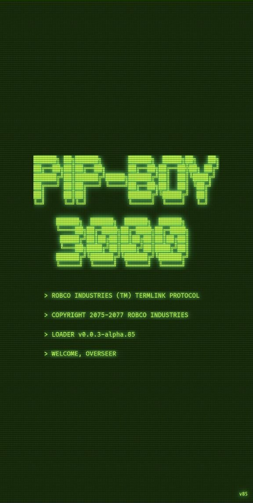 | 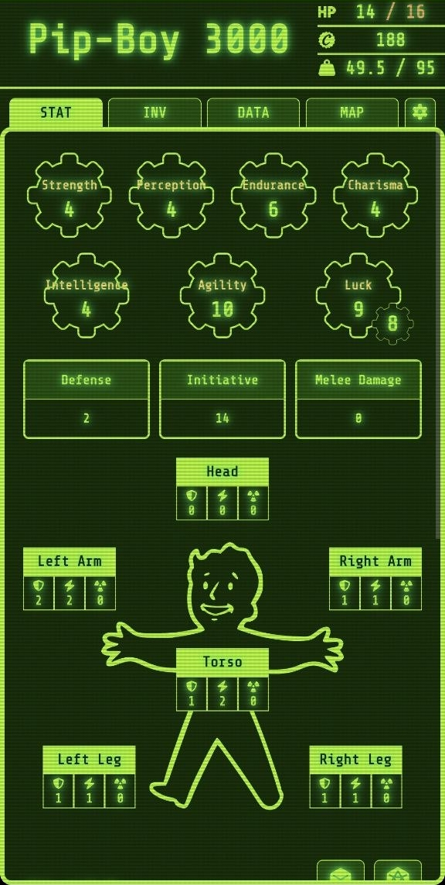 | 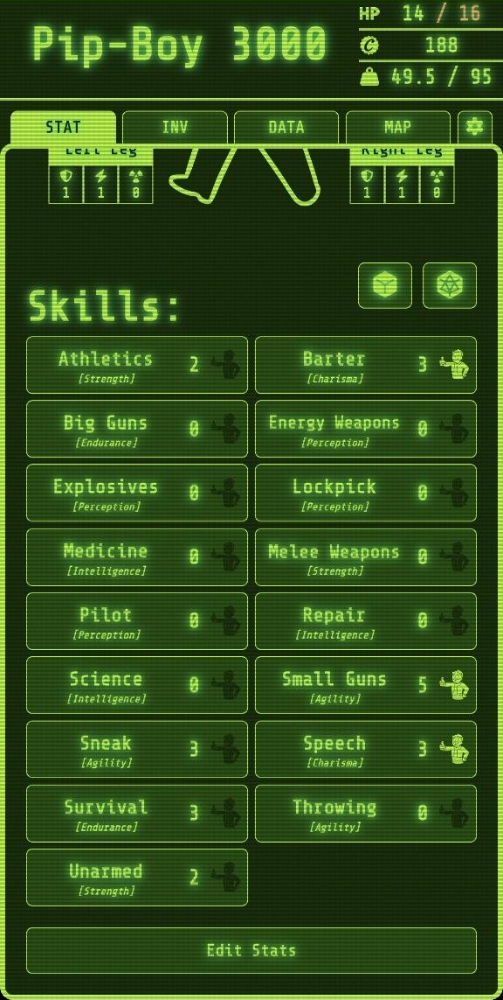 |
| **INV - Weapons** | **INV - Apparel** | **Data - Character** |
| 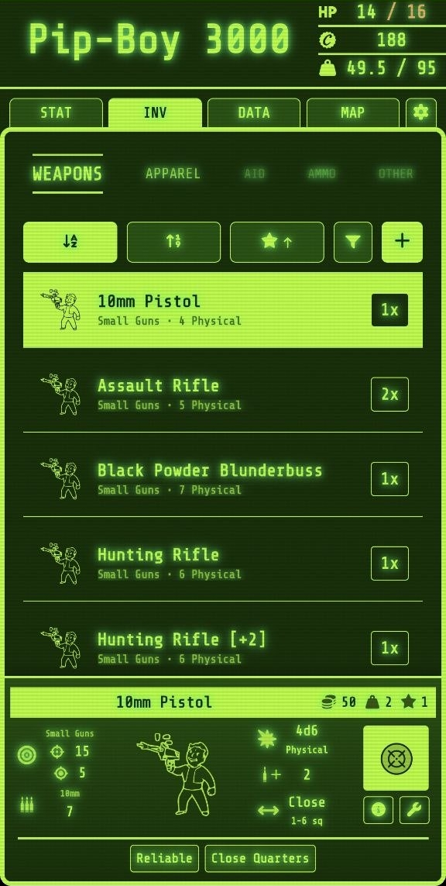 | 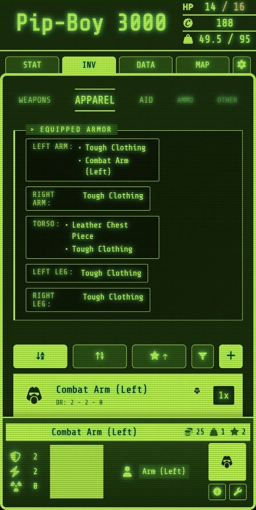 | 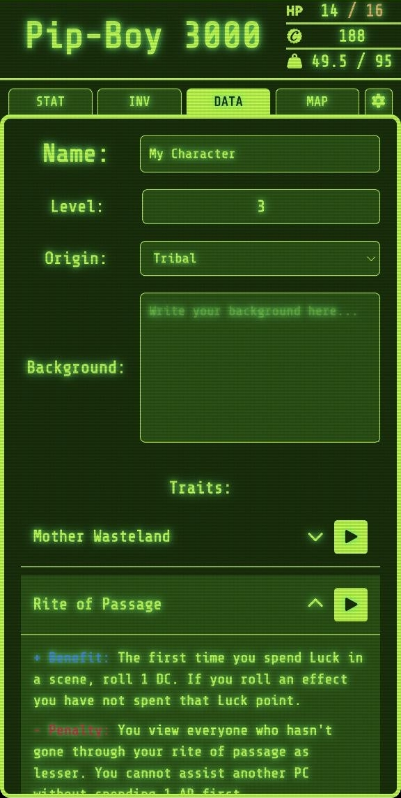 |
| **Data - Perks** | **Map Tab** | **Settings** |
| 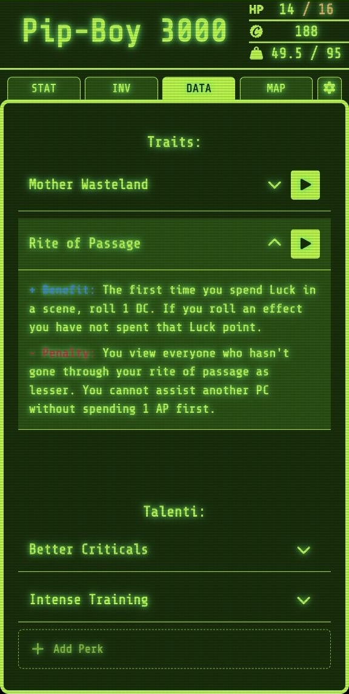 | 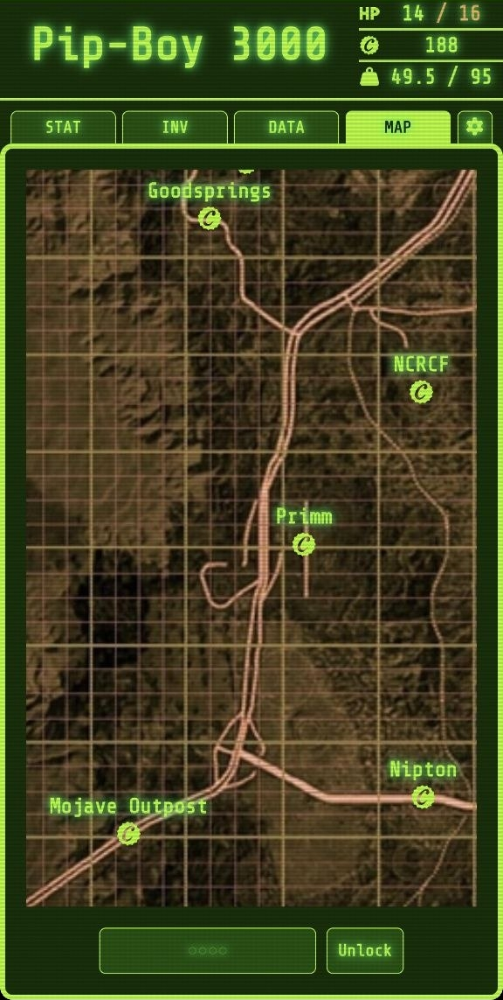 | 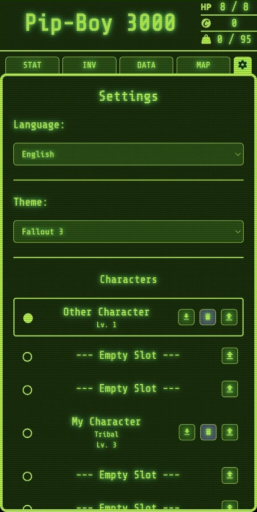 |
| **New Vegas Theme** | **Old World Blues Theme** | |
| 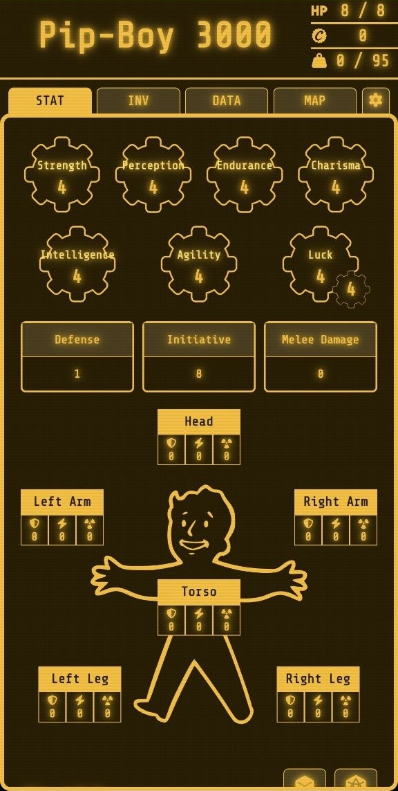 | 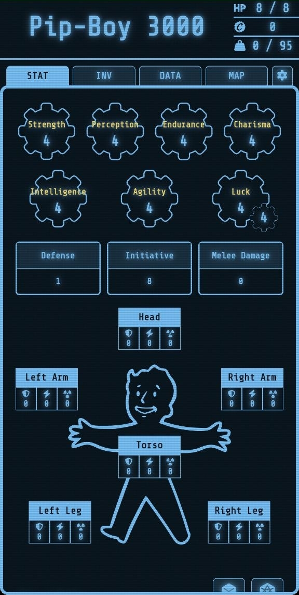 | |

---

## 📝 Usage

### Getting around

- **STAT:** edit attributes and skills; select a skill to open the D20 roller.
- **INV:** use the `+` next to a category to add items; use a weapon's crosshair button to open the D6 damage roller.
- **DATA:** manage character details, perks, and traits, including supported manual actions.
- **MAP:** explore New Vegas and Commonwealth and unlock locations with codes.
- **Header:** the PA box to the left of the title shows the Action Points value (tap it to edit). HP, caps and weight are on the right; tap them to edit.
- **Settings (gear icon)** has three sub-tabs:
    - **Characters:** select, export, import or delete character slots.
    - **System:** language, theme, region, weight unit (kg or lb), CRT effects, and Reset Memory.
    - **Party:** create or join a group, and see its members. See [Party and Action Points](#party-and-action-points-pa).
- **Companion (person icon):** appears only when the active character has companions.

On mobile, one tab is displayed at a time. On desktop-sized screens, STAT stays in the left panel while the other selected tab appears on the right.

### Party and Action Points (PA)

> **Manual at this stage.** PA are changed only when you press `+` or `-`. The app never adds or removes PA on its own, for example after a roll, a scene change, or a GM decision. Keep the count in step with your table yourself.

**Where to find it:** the PA box to the left of the title shows the current value. Tap it to open the PA popup.

**Without a party:** PA are stored on the character. Each character has its own value.

**With a party:**

1. In **Settings → Party**, create a group or enter a code shared by your table.
2. Each character in the group keeps its own PA contribution. The group PA is the sum of these contributions, limited to **0–6**.
3. The Settings → Party list shows every member, with whether they are **online** (a heartbeat in the last few minutes) or **offline** (with the last time the app was open).
4. Changes are saved on this device at once and sent to public Nostr relays. The popup shows whether they are **synced**, **waiting to sync**, or **offline** (the value is kept on the device and sent later).

**Limits to know about:**

- **Anyone with the code can join**, read the member list and change any contribution. Share the code only with your table.
- The relays are third-party services with no guarantee of keeping data. The app also keeps a copy on each device, but if a device loses its data, its contribution is lost from the group total.
- A phone that is locked or in the background sends no heartbeat, so it can appear **offline** while its player is still at the table.
- Leaving a group or deleting a character is recorded on the relays only if the device is online; otherwise it is retried later.
- **Published data:** names, origin, level, PA contribution and a heartbeat are published to the public relays above, where they can be read by anyone who has the group's code.
- Party features have not been tested on many devices or networks. Treat the group PA as a helper, not as the official record.

### Backups and transfers

> **Your characters exist only in local browser/app storage (`localStorage`). There is no account, server backup, or automatic synchronization. Export JSON backups regularly and keep them outside the browser. Installing the PWA is not a backup.**

Settings contains 10 character slots. Select a slot to switch characters; selecting an empty slot creates a default character.

To back up or move a character:

1. In Settings, use the occupied slot's export/download button to save that character as JSON. Repeat for each character you want to keep.
2. On the destination browser or device, open Settings and import the JSON into the desired slot.
3. Check the imported character before deleting the original or its backup.

**Import replaces the chosen slot without a separate overwrite confirmation. Export an occupied slot before importing over it.**

Different devices, browsers, and browser profiles have separate storage. Clearing site data, deleting a character, or using **Reset Memory** can remove saved data. Do not rely on browser storage as your only copy.

---

## Rulebook corrections and interpretations

These are current app choices or workarounds, **not official errata**. Check them with your GM.

- **Arc Welder:** uses `ammoFusionCell` because `ammoElectronChargePack` could not be found in the manuals.
- **Musket and Assaultron Head - provisional workaround:** damage 4 and fire rate 1 instead of 5 and 0, to approximate their special rule. Mods can still reduce fire rate to 0; this needs a better solution.
- **Tesla Rifle:** uses Wanderer's Guide stats and mods rather than Settler's Guide, providing more mods and damage rating 5 instead of 4.
- **Cazador Sting ammunition:** rarity 3 and weight 0, which were unspecified in the manuals.
- **Thermic Lance:** uses New Vegas stats (9 CD, Piercing 2, Vicious, Two-Handed, Parry) rather than the Wanderers' Guide stat block (6 CD, Piercing 1, Stun, Recoil 7).
- **40mm grenade cost:** 20 caps, as in the Wanderers' Guide and New Vegas, instead of 2 in the Settlers' Guide.
- **Pipe Bolt-Action:** Unreliable, as in the English Corebook (the Italian Corebook says Inaccurate).
- **Gatling Laser:** uses fusion cells; its Fusion Core Slot quality notes that each fusion core charge counts as 50 fusion cells.
- **Perk requirements "don't already have a companion":** checked only when the perk is taken, not on perks you already own.
- **Doctor's Bag:** follows the English Corebook (up to 2 additional patients during long-term care). The Italian Corebook instead says the bag is used up when two or more complications are rolled together.
- **Maria (New Vegas):** weight 2 lbs. The manual prints 6.75 lbs, the same as Thump-Thump, which looks like a copy error for a 9mm pistol.
- **AER14 Prototype:** weight read as 5 lbs; the manual prints "5" with no unit.
- **NCR Ranger Combat Armor:** the manual gives the same benefits to the armor and to the helmet (+1 Reputation with NCR groups, no hot-weather exposure, gas protection). In the app only the Ranger Helmet has the gas mask effect, which also carries the gas mask's +1 difficulty on Speech tests.
- **Targeting:** the Targeting Computer mod adds a Targeting quality (aimed targets lose cover, and the aim bonus carries to the next attack in the scene) instead of Accurate and Recon. Annabelle has the same quality built in, since the New Vegas table lists "Targeting" among its qualities.
- **New Vegas outfits:** the Boomer Jumpsuit is clothing (armor can be worn over it); Great Khan Armor, King's Outfit, Powder Ganger Outfit, Ranger Outfit and Spacesuit are outfits.

---

## 🛠️ Development

### Want to report a bug?

[Open an issue on GitHub](https://github.com/vittoema96/vittoema96.github.io/issues). Include reproduction steps, expected/actual behavior, browser/device, and language/theme when relevant. Feature requests are welcome too. If sharing an exported character, use a minimal reproduction and remove personal information first.

### Refactoring walkthrough

For a readable explanation of the character/feat architecture, save compatibility, bug fixes, and extension examples, see [Refactoring and bug fixes: a maintainer's guide](docs/refactoring-and-bug-fixes.md).

### Regression tests

Run `npm test` for domain/store checks and browser interaction regressions. Browser checks use a temporary, isolated Chrome/Chromium profile, never your saved characters. Set `CHROME_PATH` if the browser is not in a standard location; browser checks are explicitly skipped when no browser is found.

### Want to help with translations?

Translation **sources** are the bilingual JSON files under `data/sources/`. **Do not edit `src/locales/en.json` or `src/locales/it.json` directly:** they are generated and will be overwritten.

For English/Italian corrections, edit the relevant source entry, preserve both `en` and `it` values in each translation/metadata block, and run `npm run build:locales`. Metadata such as `_description`, `_benefit`, and `_penalty` becomes suffixed runtime keys; modification entries also require `_descriptor`. English is the runtime fallback, but source validation still requires both supported languages.

Adding a language requires more than submitting a standalone locale JSON. Extend the source translations, the language lists in `scripts/build_locales_from_source.py` and `scripts/validate_locales_sources.py`, the runtime resources in `src/locales/i18n.ts`, and the selectable languages in `src/services/UISettingsManager.ts`.

### Want to help with development?

<details>
<summary>Click to reveal setup, data workflow, and contribution guidelines</summary>

### Run locally

Use **Node.js 22** (the version used by the deployment workflow), **npm 9+**, and **Python 3** available as `python3`. `.nvmrc` pins Node 22.

```bash
git clone https://github.com/vittoema96/vittoema96.github.io.git
cd vittoema96.github.io
npm ci
npm run dev
```

The development server runs at **http://localhost:3000**. Both `npm run dev` and `npm run build` first validate and generate translations and game data through their npm pre-hooks.

### 🏗️ How it's built

React 19, TypeScript, and Vite provide the frontend; Zustand handles persisted character slots, i18next/react-i18next handle localization, and `vite-plugin-pwa` provides the service worker. Styling uses custom CSS with theme tokens, Font Awesome, and Iconify.

| Location | Purpose |
| --- | --- |
| `src/app/` | App shell, tabs, reusable UI, and React contexts |
| `src/features/` | Character and item rules, origins, perks, and traits |
| `src/hooks/` | Hooks, save store, and UI adapters |
| `src/schemas/`, `src/types/` | Validation and shared types |
| `src/services/`, `src/styles/` | UI settings, themes, and styling |
| `data/sources/` | Editable game-data CSVs and translation JSONs |
| `data/manifests/` | Dataset/source mappings and localization validation mappings |
| `src/data/`, `src/locales/` | Generated runtime JSON alongside loaders and supporting code |
| `scripts/` | Data/localization validation, generation, and regression checks |

### 📊 Data format

**Edit the sources, not the generated runtime files under `src/data/` and `src/locales/`.** Game content is compiled by Python before development/build, then imported as JSON by the app; it is not parsed from CSV dynamically in the browser.

| Source folder under `data/sources/` | Content |
| --- | --- |
| `weapon/` | Weapon data |
| `apparel/` | Armor, clothing, and robot parts |
| `aid/` | Food, drinks, medicines, and other aid |
| `mods/` | Weapon and apparel modifications |
| `other/` | Ammunition and miscellaneous items |
| `character-features/` | Perks, traits, companion perks, and related translations |
| `item-features/` | Legendary item effects |

`data/manifests/data.json` maps runtime datasets to their CSV sources. After changing a source, run `npm run build:data` to validate it and regenerate the runtime data under `src/data/`. Add or update the corresponding translation keys when introducing content with visible names or descriptions.

### Useful commands and checks

| Command | Purpose |
| --- | --- |
| `npm run dev` | Generate locales/data and start Vite |
| `npm run build:data` | Validate CSV sources and regenerate runtime game data |
| `npm run build:locales` | Validate translation sources and regenerate runtime locales |
| `npm test` | Domain/store regressions and browser interaction regressions |
| `npm run lint` | ESLint checks |
| `npm run type-check` | TypeScript checks without emitting files |
| `npm run format:check` | Check formatting under `src/` without writing |
| `npm run quality` | Run lint, formatting checks, and type-check in sequence |
| `npm run build` | Generate locales/data and produce the production build in `dist/` |
| `npm run preview` | Serve an existing production build locally |

`quality` does not run the test suite or production build. A successful Vite build does **not** replace `type-check`; run the relevant checks separately and report failures rather than assuming they are unrelated.

### 🤝 Contributing

Pull requests are welcome. Follow existing patterns, update source data/translations rather than generated outputs, and add regression coverage for behavior changes. Run the applicable checks above before opening a pull request. See [TODO.md](TODO.md) for the backlog and the [maintainer's guide](docs/refactoring-and-bug-fixes.md) for practical code examples.

### 📈 Versioning and deployment

The current version format is `0.0.3-alpha.BUILD_VERSION`. The project's milestone convention is `0.0.x` for alpha milestones, `0.x.0` for beta, and `x.0.0` for stable releases.

GitHub Actions replaces `BUILD_VERSION` with the workflow's **`github.run_number`**, not a count of successful deployments. Pushes to `main` and manual workflow runs build and deploy to GitHub Pages. That workflow performs the production build; it does not run the full test and quality suite.

</details>

---

### ⚖️ Disclaimer

*This is an unofficial fan project. Fallout, Pip-Boy, Vault-Tec and all related names are trademarks of Bethesda Softworks / ZeniMax Media Inc. This project is not affiliated with, endorsed by, or connected to Bethesda Softworks in any way. No copyright infringement is intended. This app is free, non-commercial, and made purely for fan enjoyment.*

---

### 📜 Third-party Licenses & Credits

| Asset | Source | License |
|---|---|---|
| Map marker icons (game-icons:*) | [game-icons.net](https://game-icons.net) — Lorc, Delapouite & contributors | [CC BY 3.0](https://creativecommons.org/licenses/by/3.0/) |
| UI icons (fa6-solid:*) | [Font Awesome Free](https://fontawesome.com) — Fonticons, Inc. | [CC BY 4.0](https://creativecommons.org/licenses/by/4.0/) |
| UI icons (mdi:*) | [Material Design Icons](https://materialdesignicons.com) | [Apache 2.0](https://www.apache.org/licenses/LICENSE-2.0) |
| Fonts (Fira Code, Roboto Mono, Share Tech Mono) | Google Fonts / Fontsource | SIL OFL 1.1 |
| Other open source libraries | See [`package.json`](package.json) | Their respective licenses |
