# General warnings

> # ⚠️ Fan Project ⚠️
> I'm an **inexperienced programmer**, a game master, and a lifelong Fallout fan.
> This is a fan project made:
> - Mainly for my own group.
> - By a non-native English speaker.
> - To learn stuff: expect bugs, shitty code, and things that still need improving.
> - By just me, in my free time: updates may be frequent or stop altogether.

> # ⚠️ WORK IN PROGRESS ⚠️
>
> - **This is an alpha project.** Many features and rules are incomplete, and calculations may be wrong. A selectable option is not necessarily fully supported.
> - **Please double-check calculations and data against your rulebooks and GM's decisions.** If something looks wrong, [open an issue on GitHub](https://github.com/vittoema96/vittoema96.github.io/issues).
> - The interface is mobile-first, primarily tested around **412 x 915 px**. Desktop has a two-panel layout, but device and browser coverage is limited.
> - **Back up your characters:** saves are local only. See [backups and transfers](#backups-and-transfers).

---

# Pip-Boy 3000 - PWA Companion App

# -> [**Open the app**](https://vittoema96.github.io) <-


A free, unofficial companion for a Fallout-themed tabletop RPG. Manage characters, inventory, companions, and dice rolls in a Pip-Boy-inspired interface, directly in your browser or as an installed Progressive Web App (PWA).

#### Languages 🇺🇸🇮🇹
English and Italian, selectable in Settings ⚙️.

---

## 📲 Install as an App (and run it offline)

You can use the app directly at [vittoema96.github.io](https://vittoema96.github.io); installation is optional.

- **Android / iOS:** look for **Install app** or **Add to Home Screen** in the browser's menu or share sheet.
- **Desktop:** supported browsers may show an install icon in the address bar or an installation menu entry.

The exact steps and availability depend on your browser and operating system. If installation is unavailable, you can still use the website.

For offline use, first load the app **while online** and allow its files to finish downloading and caching. Offline availability depends on that cache, not simply on having a home-screen icon. Clearing site data can remove both the offline cache and your saves.

---

# What is NOT present...

## ...and still needs implementation

There are no promised completion dates. If you need a particular missing rule, [open an issue](https://github.com/vittoema96/vittoema96.github.io/issues).

### Perk effects (~80% without an implementation)

The catalog includes Core Rulebook and DLC perks, but most effects are not automatically applied. As of **2026-10-19**, **36 of 176 perks (~20.5%)** have a registered implementation, including automatic effects and manual actions; **140 (~79.5%)** do not.

### DLC origins

Origins can be selectable even when their rules are incomplete, particularly DLC origins. Tribal and NCR support also has remaining TODOs; **selection alone is not a promise of full automation**.

### Trait effects (~41% without an implementation)

As of **2026-10-19**, **17 of 29 traits (~58.6%)** have a registered implementation; **12 (~41.4%)** do not. These totals include fixed origin traits. Among the 21 selectable traits, **16 (~76.2%)** have an implementation and **5 (~23.8%)** do not.

> **What strikethrough means:** a ~~crossed-out perk or trait~~ **can still be selected**, provided its normal selection requirements are met. Its gameplay effects are **not applied anywhere in the app**: only its description is shown, so you must account for those effects yourself.
>
> The percentages above count **distinct IDs with registered modules, not individual ranks or complete rule coverage**. They include automatic effects, manual actions, and partial implementations. A name without strikethrough is **not** a guarantee that every aspect of its rules is automated.

### Aid item consumption

Aid items cannot currently be consumed with a working one-click action. Automatic effect-duration management is also missing.

### Power armor

Dedicated power armor data and rule support are not implemented.

### Magazines

Magazine data and rule support are not implemented.

## ...and will not be implemented anytime soon

These features are not on the near-term roadmap and may remain outside the app's scope or require manual handling.

### A "Party" system

The app runs locally, with no backend, shared party, or connection to other players or a Game Master. There is no cloud synchronization.

### Action Points tracking

Action Points belong to the party, so the app does not maintain the cumulative AP pool. It can, however, **show when AP are used**.

### "Scene" mechanics

The app does not track when a scene starts or ends. Timing, eligibility, and once-per-scene limits must be handled by you and your GM.

Some effects already have **manual activation buttons** that handle part of their rules:

- **Rite of Passage:** rolls one combat die; confirming an effect restores one Luck, up to the character's maximum.
- **Mother Wasteland:** spends one Luck when you confirm activation.
- **Mysterious Stranger:** opens its special skill roller and spends one Luck only when the first roll is made, not merely when the popup opens.

**These buttons do not enforce scene limits or replace GM decisions.** For example, it is still up to you to use Rite of Passage only when its once-per-scene conditions are met.

---

## ✨ Features

- **Character stat management:**
    - Track S.P.E.C.I.A.L., skills, and specialties.
    - Calculate derived statistics such as Defense, Initiative, Melee Damage, HP, and carrying capacity.
    - Apply supported origin, perk, and trait effects.
    - Save changes automatically to local browser storage.
- **Inventory:**
    - Weapons, apparel, supplies, and ammunition in expandable item cards.
    - Weapon and apparel modifications, plus equipment-layer conflict detection.
    - Long-press actions to sell or remove items.
    - Feat-granted items keep their mods, custom names, quantities, and configuration when the feat is inactive. Hidden or replaced grants remain saved but are excluded from active inventory and calculations; reactivation restores their configuration.
    - Unarmed strikes, gun bashes, and mod-derived attacks are calculated views, not extra saved equipment.
    - Ammunition spending preserves hidden grants and consumes the total cost once across active stacks. Weapons that use themselves as ammunition consume only the selected configuration.
- **Integrated dice roller:**
    - D20 skill checks with automatic target-number calculation.
    - D6 damage rolls with supported extra hits and damage effects.
    - Selected burst ammunition is reserved until the damage popup closes; perk actions cannot spend those reserved rounds.
    - Luck options for supported rerolls and bonuses.
- **Companions:**
    - View and manage companions attached to the active character.
    - A dedicated companion tab appears when the character has companions.
- **Interactive map:**
    - Zoomable and pannable **New Vegas map only**.
    - Unlock markers using the [codes below](#-map-unlock-codes).
- **Settings:**
    - English and Italian.
    - Fallout 3 (green), New Vegas (amber), Old World Blues (blue), Dead Money (red), The Institute (white), and The Kings (purple) themes.
    - CRT effects with normal, no-flicker, and off options.
    - Up to **10 character slots**, with per-character JSON import/export. See [backups and transfers](#backups-and-transfers).

---

### 📍 Map Unlock Codes

Enter a location's code in the MAP tab to unlock its marker. This reference contains spoilers.

<details>
<summary>Click to reveal New Vegas Map Codes</summary>

| Location | Code | Location | Code |
| --- | --- | --- | --- |
| 188 Trading Post | `188t` | Nellis Air Force Base | `n4fb` |
| Abandoned BoS Bunker | `ab0s` | Nelson | `n3l5` |
| Aerotech Office Park | `4r0t` | New Vegas Medical Clinic | `nvmc` |
| Atomic Wrangler | `at0m` | New Vegas Strip | `nvg5` |
| Bitter Springs | `b15p` | Nipton | `n1pt` |
| Black Mountain | `bm0t` | North Vegas Square | `nv3s` |
| Boulder City | `b0ul` | Northern Passage | `nrps` |
| Camp Forlorn Hope | `c4fh` | Novac | `nv4c` |
| Camp Golf | `c4g0` | Old Mormon Fort | `0mm4` |
| Camp McCarran | `cmcc` | Primm | `pr1m` |
| Camp Searchlight | `cmsl` | Quarry Junction | `quju` |
| Canyon Wreckage | `cnwr` | Ranger Station Alpha | `rs4l` |
| Cassidy Caravan Wreckage | `ccwr` | Ranger Station Bravo | `rs8r` |
| Cottonwood Cove | `c0tt` | Ranger Station Charlie | `rsc3` |
| Crimson Caravan Company | `cc4c` | Ranger Station Delta | `rsd3` |
| Follower's Outpost | `f040` | Ranger Station Echo | `rs3c` |
| Freeside East Gate | `fr3g` | Ranger Station Foxtrot | `rsfx` |
| Freeside North Gate | `frng` | Red Rock Canyon | `rrck` |
| Gibson Scrap Yard | `g1sy` | REPCONN Headquarters | `r3h3` |
| Goodsprings | `g00d` | REPCONN Test Site | `r3tt` |
| Goodsprings Cemetery | `gc3m` | Silver Rush | `slvr` |
| Grub n Gulp Rest Stop | `gngp` | Sloan | `sl4n` |
| Gun Runners | `gunr` | Sunset Sarsaparilla HQ | `sshq` |
| H&H Tools Factory | `hhtf` | The Fort | `th4t` |
| HELIOS One | `h3l1` | The Thorn | `t3th` |
| Hidden Valley | `h1v4` | Vault 11 | `vt11` |
| Hoover Dam | `h00v` | Vault 19 | `vt19` |
| Jacobstown | `j4ck` | Vault 21 | `vt21` |
| King's School of Impersonation | `ks01` | Vault 22 | `vt22` |
| Legate's Camp | `l3g4` | Vault 3 | `vt03` |
| Mojave Drive-In | `m0d1` | Vault 34 | `vt34` |
| Mojave Outpost | `m00t` | Westside South Entrance | `w3s3` |
| NCR Sharecropper Farms | `ncrs` | Westside West Entrance | `w3w3` |
| NCRCF | `ncrc` |  |  |

</details>

---

## 📸 Screenshots

| **Boot Screen** | **Stats - SPECIAL** | **Stats - Skills** |
| :---: | :---: | :---: |
| 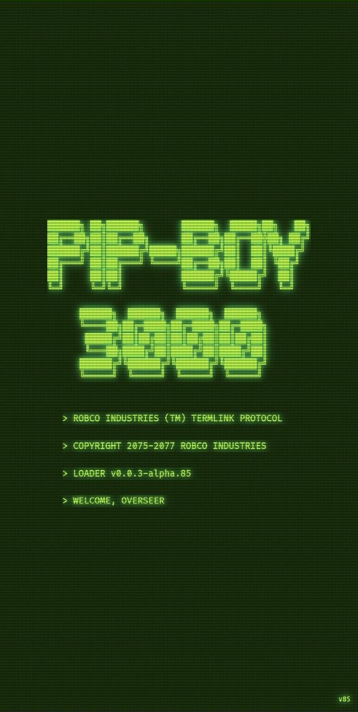 | 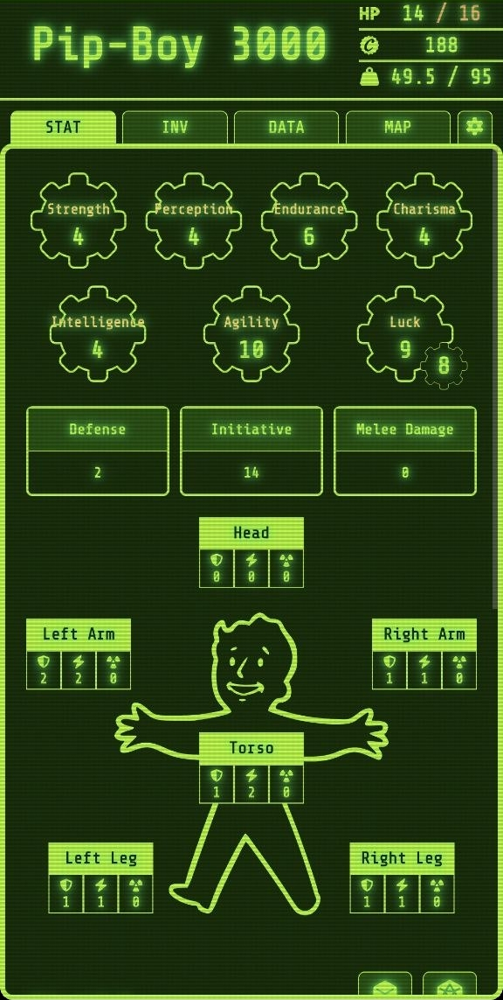 | 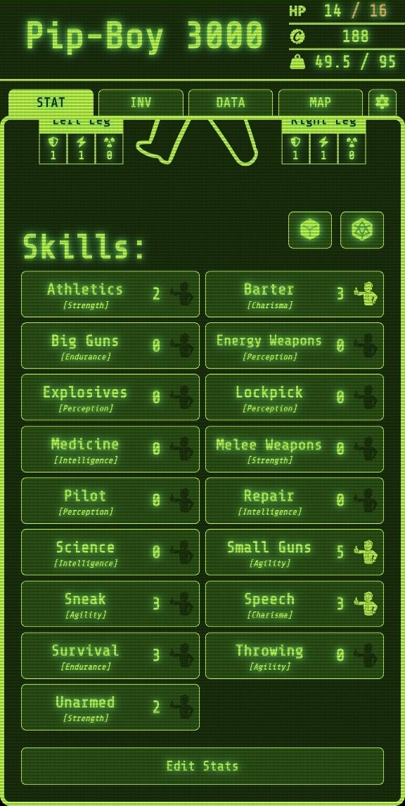 |
| **INV - Weapons** | **INV - Apparel** | **Data - Character** |
| 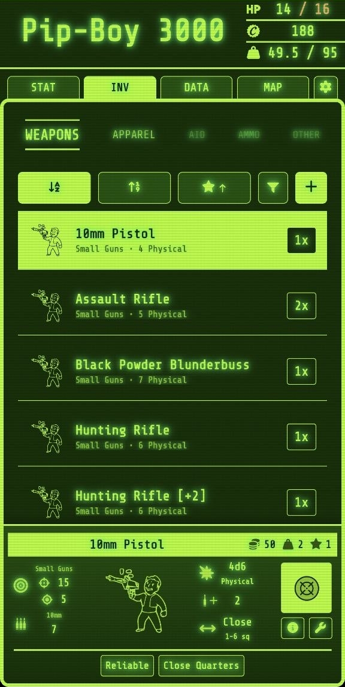 | 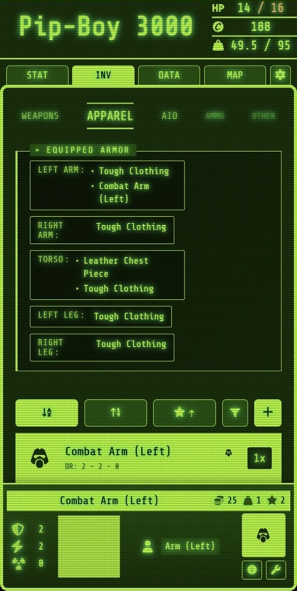 | 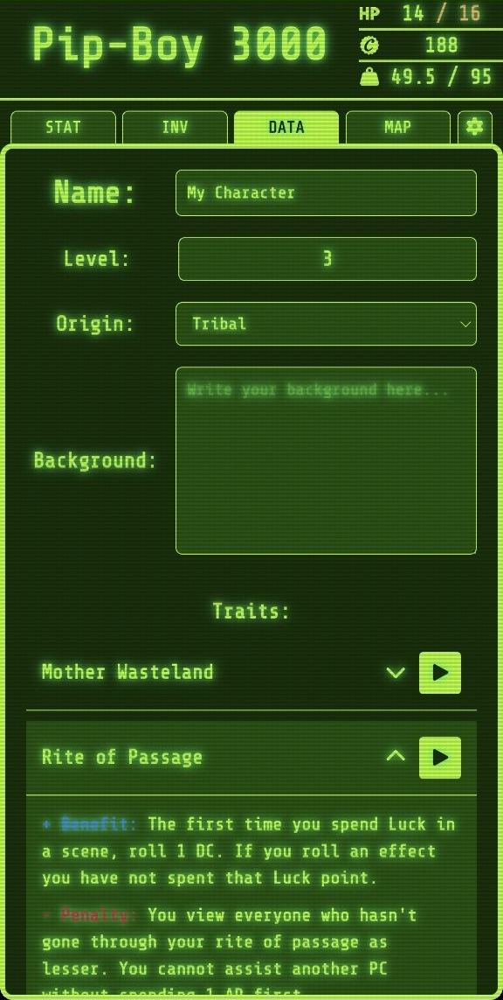 |
| **Data - Perks** | **Map Tab** | **Settings** |
| 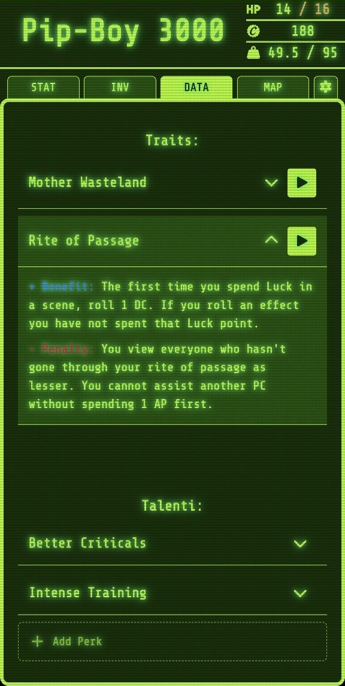 | 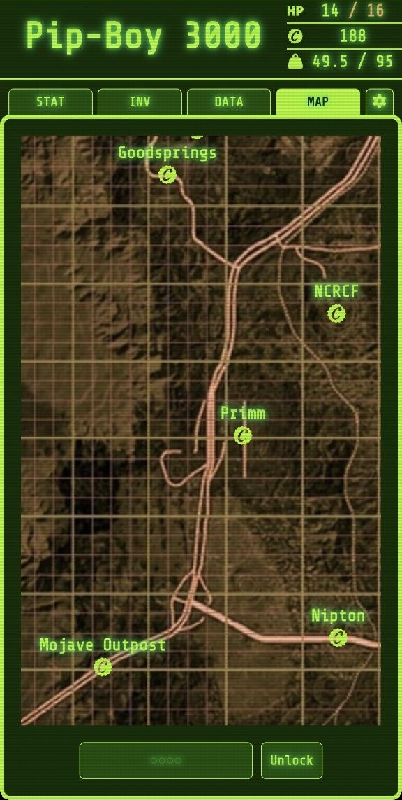 | 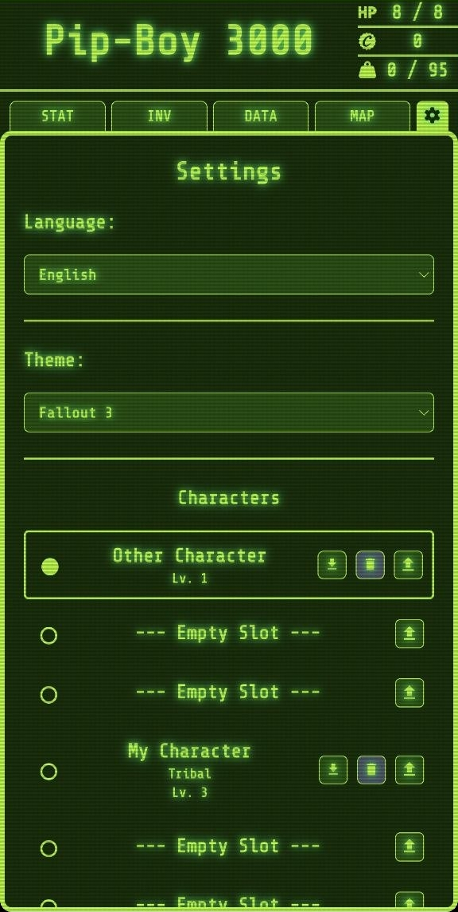 |
| **New Vegas Theme** | **Old World Blues Theme** | |
| 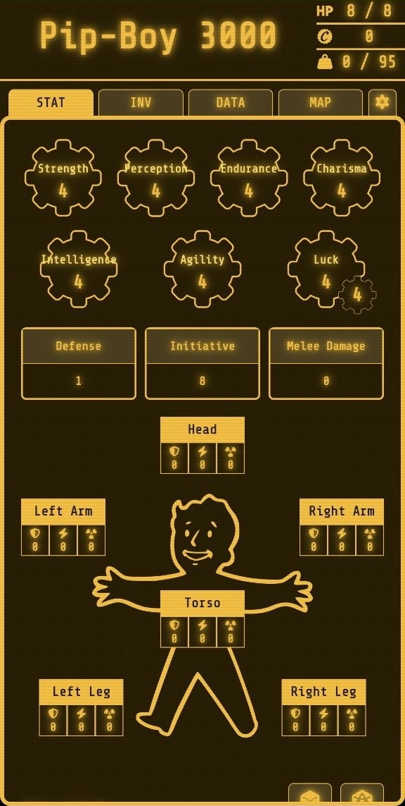 | 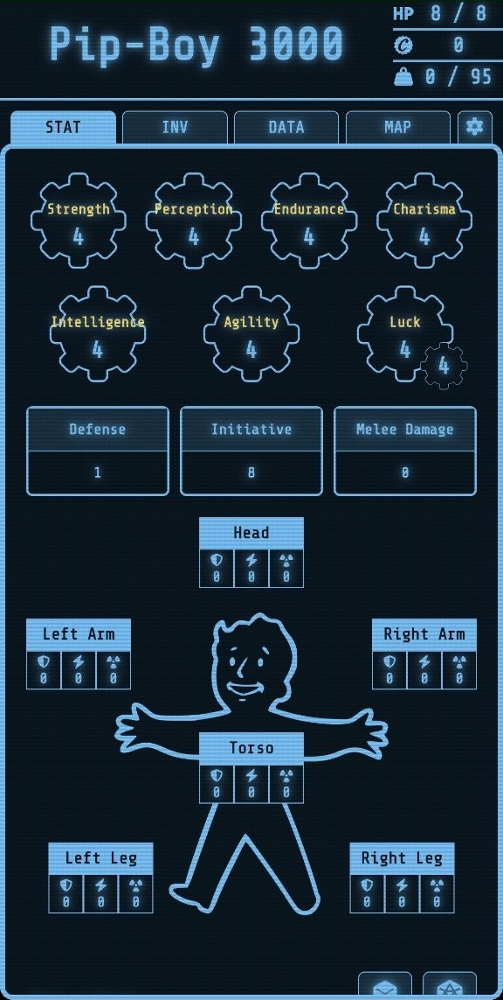 | |

---

## 📝 Usage

### Getting around

- **STAT:** edit attributes and skills; select a skill to open the D20 roller.
- **INV:** use the `+` next to a category to add items; use a weapon's crosshair button to open the D6 damage roller.
- **DATA:** manage character details, perks, and traits, including supported manual actions.
- **MAP:** explore New Vegas and unlock locations with codes.
- **Settings (gear icon):** change language, theme, CRT effects, and character slots.
- **Companion (person icon):** appears only when the active character has companions.

On mobile, one tab is displayed at a time. On desktop-sized screens, STAT stays in the left panel while the other selected tab appears on the right.

### Backups and transfers

> **Your characters exist only in local browser/app storage (`localStorage`). There is no account, server backup, or automatic synchronization. Export JSON backups regularly and keep them outside the browser. Installing the PWA is not a backup.**

Settings contains 10 character slots. Select a slot to switch characters; selecting an empty slot creates a default character.

To back up or move a character:

1. In Settings, use the occupied slot's export/download button to save that character as JSON. Repeat for each character you want to keep.
2. On the destination browser or device, open Settings and import the JSON into the desired slot.
3. Check the imported character before deleting the original or its backup.

**Import replaces the chosen slot without a separate overwrite confirmation. Export an occupied slot before importing over it.**

Different devices, browsers, and browser profiles have separate storage. Clearing site data, deleting a character, or using **Reset Memory** can remove saved data. Do not rely on browser storage as your only copy.

---

## Rulebook corrections and interpretations

These are current app choices or workarounds, **not official errata**. Check them with your GM.

- **Arc Welder:** uses `ammoFusionCell` because `ammoElectronChargePack` could not be found in the manuals.
- **Musket and Assaultron Head - provisional workaround:** damage 4 and fire rate 1 instead of 5 and 0, to approximate their special rule. Mods can still reduce fire rate to 0; this needs a better solution.
- **Tesla Rifle:** uses Wanderer's Guide stats and mods rather than Settler's Guide, providing more mods and damage rating 5 instead of 4.
- **Cazador Sting ammunition:** rarity 3 and weight 0, which were unspecified in the manuals.

---

## 🛠️ Development

### Want to report a bug?

[Open an issue on GitHub](https://github.com/vittoema96/vittoema96.github.io/issues). Include reproduction steps, expected/actual behavior, browser/device, and language/theme when relevant. Feature requests are welcome too. If sharing an exported character, use a minimal reproduction and remove personal information first.

### Refactoring walkthrough

For a readable explanation of the character/feat architecture, save compatibility, bug fixes, and extension examples, see [Refactoring and bug fixes: a maintainer's guide](docs/refactoring-and-bug-fixes.md).

### Regression tests

Run `npm test` for domain/store checks and browser interaction regressions. Browser checks use a temporary, isolated Chrome/Chromium profile, never your saved characters. Set `CHROME_PATH` if the browser is not in a standard location; browser checks are explicitly skipped when no browser is found.

### Want to help with translations?

Translation **sources** are the bilingual JSON files under `data/sources/`. **Do not edit `src/locales/en.json` or `src/locales/it.json` directly:** they are generated and will be overwritten.

For English/Italian corrections, edit the relevant source entry, preserve both `en` and `it` values in each translation/metadata block, and run `npm run build:locales`. Metadata such as `_description`, `_benefit`, and `_penalty` becomes suffixed runtime keys; modification entries also require `_descriptor`. English is the runtime fallback, but source validation still requires both supported languages.

Adding a language requires more than submitting a standalone locale JSON. Extend the source translations, the language lists in `scripts/build_locales_from_source.py` and `scripts/validate_locales_sources.py`, the runtime resources in `src/locales/i18n.ts`, and the selectable languages in `src/services/UISettingsManager.ts`.

### Want to help with development?

<details>
<summary>Click to reveal setup, data workflow, and contribution guidelines</summary>

### Run locally

Use **Node.js 22.12+**, **npm 9+**, and **Python 3** available as `python3`. Deployment uses Node 22; the older Node 18 minimum in `package.json` does not reflect the current Vite toolchain's requirements.

```bash
git clone https://github.com/vittoema96/vittoema96.github.io.git
cd vittoema96.github.io
npm ci
npm run dev
```

The development server runs at **http://localhost:3000**. Both `npm run dev` and `npm run build` first validate and generate translations and game data through their npm pre-hooks.

### 🏗️ How it's built

React 19, TypeScript, and Vite provide the frontend; Zustand handles persisted character slots, i18next/react-i18next handle localization, and `vite-plugin-pwa` provides the service worker. Styling uses custom CSS with theme tokens, Font Awesome, and Iconify.

| Location | Purpose |
| --- | --- |
| `src/app/` | App shell, tabs, reusable UI, and React contexts |
| `src/features/` | Character and item rules, origins, perks, and traits |
| `src/hooks/` | Hooks, save store, and UI adapters |
| `src/schemas/`, `src/types/` | Validation and shared types |
| `src/services/`, `src/styles/` | UI settings, themes, and styling |
| `data/sources/` | Editable game-data CSVs and translation JSONs |
| `data/manifests/` | Dataset/source mappings and localization validation mappings |
| `src/data/`, `src/locales/` | Generated runtime JSON alongside loaders and supporting code |
| `scripts/` | Data/localization validation, generation, and regression checks |

### 📊 Data format

**Edit the sources, not generated runtime files or the legacy `public/data/` copies.** Game content is compiled by Python before development/build, then imported as JSON by the app; it is not parsed from CSV dynamically in the browser.

| Source folder under `data/sources/` | Content |
| --- | --- |
| `weapon/` | Weapon data |
| `apparel/` | Armor, clothing, and robot parts |
| `aid/` | Food, drinks, medicines, and other aid |
| `mods/` | Weapon and apparel modifications |
| `other/` | Ammunition and miscellaneous items |
| `character-features/` | Perks, traits, companion perks, and related translations |
| `item-features/` | Legendary item effects |

`data/manifests/data.json` maps runtime datasets to their CSV sources. After changing a source, run `npm run build:data` to validate it and regenerate the runtime data under `src/data/`. Add or update the corresponding translation keys when introducing content with visible names or descriptions.

### Useful commands and checks

| Command | Purpose |
| --- | --- |
| `npm run dev` | Generate locales/data and start Vite |
| `npm run build:data` | Validate CSV sources and regenerate runtime game data |
| `npm run build:locales` | Validate translation sources and regenerate runtime locales |
| `npm test` | Domain/store regressions and browser interaction regressions |
| `npm run lint` | ESLint checks |
| `npm run type-check` | TypeScript checks without emitting files |
| `npm run format:check` | Check formatting under `src/` without writing |
| `npm run quality` | Run lint, formatting checks, and type-check in sequence |
| `npm run build` | Generate locales/data and produce the production build in `dist/` |
| `npm run preview` | Serve an existing production build locally |

`quality` does not run the test suite or production build. A successful Vite build does **not** replace `type-check`; run the relevant checks separately and report failures rather than assuming they are unrelated.

### 🤝 Contributing

Pull requests are welcome. Follow existing patterns, update source data/translations rather than generated outputs, and add regression coverage for behavior changes. Run the applicable checks above before opening a pull request. See [TODO.md](TODO.md) for the backlog and the [maintainer's guide](docs/refactoring-and-bug-fixes.md) for practical code examples.

### 📈 Versioning and deployment

The current version format is `0.0.3-alpha.BUILD_VERSION`. The project's milestone convention is `0.0.x` for alpha milestones, `0.x.0` for beta, and `x.0.0` for stable releases.

GitHub Actions replaces `BUILD_VERSION` with the workflow's **`github.run_number`**, not a count of successful deployments. Pushes to `main` and manual workflow runs build and deploy to GitHub Pages. That workflow performs the production build; it does not run the full test and quality suite.

</details>

---

### ⚖️ Disclaimer

*This is an unofficial fan project. Fallout, Pip-Boy, Vault-Tec and all related names are trademarks of Bethesda Softworks / ZeniMax Media Inc. This project is not affiliated with, endorsed by, or connected to Bethesda Softworks in any way. No copyright infringement is intended. This app is free, non-commercial, and made purely for fan enjoyment.*

---

### 📜 Third-party Licenses & Credits

| Asset | Source | License |
|---|---|---|
| Map marker icons (game-icons:*) | [game-icons.net](https://game-icons.net) — Lorc, Delapouite & contributors | [CC BY 3.0](https://creativecommons.org/licenses/by/3.0/) |
| UI icons (fa6-solid:*) | [Font Awesome Free](https://fontawesome.com) — Fonticons, Inc. | [CC BY 4.0](https://creativecommons.org/licenses/by/4.0/) |
| UI icons (mdi:*) | [Material Design Icons](https://materialdesignicons.com) | [Apache 2.0](https://www.apache.org/licenses/LICENSE-2.0) |
| Fonts (Fira Code, Roboto Mono, Share Tech Mono) | Google Fonts / Fontsource | SIL OFL 1.1 |
| Other open source libraries | See [`package.json`](package.json) | Their respective licenses |
